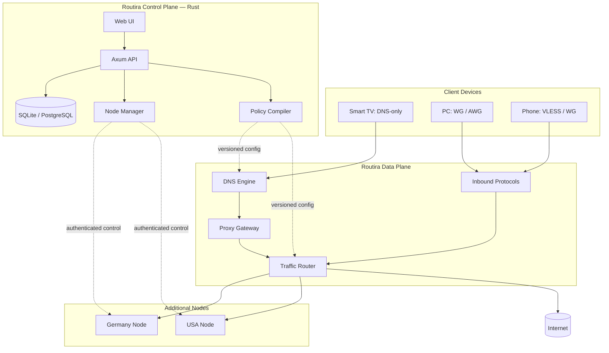
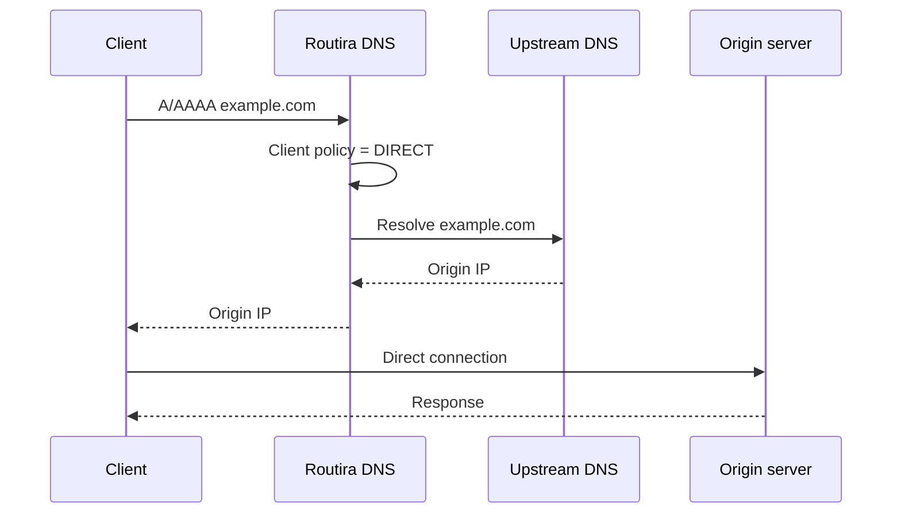
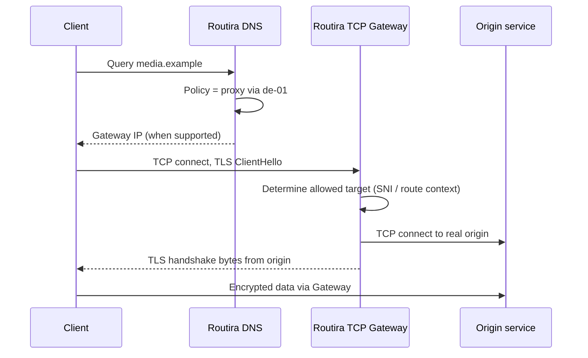
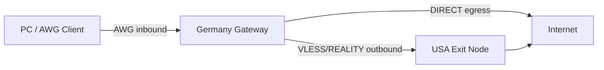
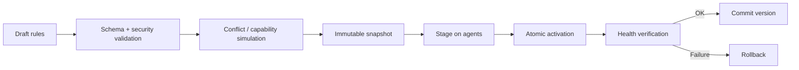

# Routira — Self-Hosted SmartDNS, Proxy & Multi-Protocol Network Platform

> **Complete concept, product requirements, and technical development specification**  
> **Document language:** English  
> **Date:** October 12, 2026  
> **Status:** Architectural proposal / project specification, not documentation of already implemented software  
> **Proposed primary stack:** Rust + React/TypeScript  
> **Distribution model:** Self-hosted, initially on Linux VPS; Routira's license has not yet been selected

---

## Table of Contents

1. [Concept and Goals](#1-concept-and-goals)
2. [Primary Use Cases](#2-primary-use-cases)
3. [Fundamental Technical Limitations](#3-fundamental-technical-limitations)
4. [Operating Modes](#4-operating-modes)
5. [High-Level Architecture](#5-high-level-architecture)
6. [Network Flows: DNS, SmartDNS, Tunnels](#6-network-flows-dns-smartdns-tunnels)
7. [Multi-Protocol Infrastructure](#7-multi-protocol-infrastructure)
8. [Policy Engine and Rule System](#8-policy-engine-and-rule-system)
9. [DNS Engine](#9-dns-engine)
10. [Proxy Gateway and Routing](#10-proxy-gateway-and-routing)
11. [Control Plane, Node Agent, and Synchronization](#11-control-plane-node-agent-and-synchronization)
12. [Routira Web Dashboard](#12-routira-web-dashboard)
13. [Design System and UX Principles](#13-design-system-and-ux-principles)
14. [Device Onboarding and Profiles](#14-device-onboarding-and-profiles)
15. [Rust Technology Stack](#15-rust-technology-stack)
16. [Recommended Repository Structure](#16-recommended-repository-structure)
17. [Domain Model and Data Schema](#17-domain-model-and-data-schema)
18. [API and Internal Contracts](#18-api-and-internal-contracts)
19. [Security and Privacy](#19-security-and-privacy)
20. [Monitoring, Diagnostics, and Resilience](#20-monitoring-diagnostics-and-resilience)
21. [Deployment and Operations](#21-deployment-and-operations)
22. [Testing and Quality Criteria](#22-testing-and-quality-criteria)
23. [Development Phases and MVP Scope](#23-development-phases-and-mvp-scope)
24. [Definition of Done and Product Decisions](#24-definition-of-done-and-product-decisions)
25. [Risks, Trade-offs, and Open Questions](#25-risks-trade-offs-and-open-questions)
26. [Glossary](#26-glossary)
27. [Sources and Technical References](#27-sources-and-technical-references)

---

## 1. Concept and Goals

### 1.1. What Is Routira?

**Routira** is a self-hosted platform for managing DNS and traffic routing that combines:

- **SmartDNS:** centralized DNS policies, conditional response rewriting, upstream resolver selection, caching, and filtering;
- **Selective Proxy:** selectively forwarding compatible connections through exit nodes;
- **VPN / Tunnels:** WireGuard, AmneziaWG, and other tunnel-based ways of connecting devices;
- **Proxy Protocols:** Xray/VLESS+REALITY, SOCKS5, HTTP CONNECT, and eventually Shadowsocks, Hysteria 2, TUIC, and Trojan;
- **Multi-Node:** multiple VPS instances and exit IPs, with region, route, and fallback-node selection;
- **Unified Control Plane:** a single web dashboard for devices, profiles, rules, nodes, and statistics;
- **Diagnostics:** explainable Policy Engine decisions and network checks before and after configuration changes.

The platform is **more than a VPN dashboard**. Its central purpose is to let users control *which traffic, from which client, travels along which route and exits through which endpoint*.

### 1.2. Product Positioning

> **Routira — intelligent routing without the need to manually manage numerous configurations and services.**

The product must not conceal its limitations: DNS-only configuration on a television does not provide the same capabilities as an installed VPN client on a computer.

### 1.3. Target Audience

- People running a single personal VPS.
- Users with several devices (PC, smartphone, TV, game console, router).
- Users with exit points in multiple geographic locations.
- Technical enthusiasts who need flexible DNS and networking policies.
- Small home networks and labs with managed rules.

The initial product **is not intended** to be a public commercial VPN service, a hosting platform for unrelated customers, or an unrestricted public proxy.

### 1.4. Product Principles

1. **Self-hosted first:** users own the infrastructure, configuration, and keys.
2. **Rust-native core:** the main first-party server logic is written in Rust.
3. **Protocol agnostic:** a shared Control Plane with independent protocol adapters.
4. **Secure by default:** restricted endpoints, least privilege, and rejection of unsafe configurations.
5. **Transparent routing:** users can see why a DIRECT/PROXY/BLOCK decision was made.
6. **Capability-aware UX:** the dashboard shows which modes are technically supported by the selected device and engine.
7. **No hidden MITM:** under normal operation, Routira does not decrypt HTTPS or replace website certificates.
8. **Atomic updates:** an invalid rule must not break the currently working configuration.
9. **Privacy first:** minimize retention of DNS history and connection data.
10. **Gradual complexity:** begin with one VPS and basic routes, and introduce advanced topologies later.

### 1.5. Non-Goals of the First Version

- Guaranteed access to every service merely by changing DNS.
- Universal QUIC/UDP routing without a tunnel or suitable client.
- Guaranteed invisibility of traffic to ISPs or deep packet inspection (DPI).
- Automatically intercepting applications that ignore system DNS.
- Seamlessly migrating active TCP sessions when changing protocols.
- Inventing new cryptography or implementing every VPN protocol from scratch.
- Full multi-tenancy, billing, and large-scale customer hosting.

---

## 2. Primary Use Cases

### 2.1. Selective Proxying for Specific Domains

The user configures:

| Destination | Action | Exit Point |
|---|---|---|
| `media.example` and required subdomains | PROXY | `de-01` |
| `game.example` | PROXY | `us-01` |
| `bank.example` | DIRECT | Not proxied |
| `ads.example` | BLOCK | None |
| Everything else | DIRECT | Depends on connection type |

**Important:** DIRECT means connecting directly *from the point where the routing decision is made*. With client-side split tunneling, that may mean the user's home internet connection; on a VPS Gateway, DIRECT means internet access through the VPS's IP address.

### 2.2. Television with DNS-Only Configuration

- The owner enters the Routira DNS server IP in the TV or router settings.
- The device can use DNS caching, filtering, and ordinary name resolution.
- Compatible TCP/TLS services may be redirected to the SmartDNS gateway.
- No guarantees are possible for ECH, HTTP/3, nonstandard ports, or applications using their own DNS.
- The UI displays `DNS-only: limited compatibility` next to the TV profile.

### 2.3. Computer Using a Full Tunnel

- The computer connects to Routira using WireGuard or AmneziaWG.
- Routes are selected on the client or on the tunnel gateway, depending on the topology.
- An inbound tunnel can forward traffic to a particular exit node, including through another protocol.
- Individual profiles and DNS policies can be assigned to clients.

### 2.4. Multiple Protocols on One Node

One VPS may host independent listeners:

- WireGuard — a UDP endpoint;
- AmneziaWG — a separate UDP endpoint;
- Xray with VLESS+REALITY — a compatible TCP endpoint;
- SmartDNS — DNS over UDP/TCP and, when needed, DoH/DoT;
- Routira Admin/API — a separate HTTPS endpoint (preferably private).

Ports and addresses must be allocated without conflicts. It must not be claimed that all these services can automatically share the same `:443` listener.

### 2.5. Inter-Server Routing

Example: PC → AWG → Germany → VLESS/REALITY → USA → destination website.

Different protocols are used on different segments of the path. The AWG tunnel **terminates** at the German node, after which routed traffic is sent over a different transport. This is not on-the-fly conversion of AWG packets into VLESS packets.

### 2.6. Failover

If the primary exit node `us-01` becomes unavailable, the Gateway can try `us-02` or, depending on policy, block the connection. Automatic fallback for DNS-only redirection and active sessions has limitations; switching inbound protocols requires a client that supports both protocols.

---

## 3. Fundamental Technical Limitations

These requirements are mandatory and must inform architecture, testing, and UI behavior.

### 3.1. DNS Is Not a VPN

DNS returns a destination address. If Routira returns a website's real IP address, the subsequent connection usually runs **directly from the client to the website** and does not pass through Routira.

If Routira returns the address of its own proxy gateway, the client connects to that address, but correct forwarding is possible **only with a mechanism for determining the original destination** and a compatible protocol.

### 3.2. SNI and Encrypted Client Hello Limitations

With conventional HTTPS over TCP, the website name is often exposed in TLS ClientHello/SNI. A TCP passthrough gateway can use that name to select the destination **without decrypting HTTPS**.

However, **Encrypted Client Hello (ECH, RFC 9849)** hides the inner SNI. In this case, the gateway cannot reliably identify the real domain using TLS ClientHello alone. Possible alternatives include an authenticated explicit proxy, a tunnel, dedicated addresses/routes for the domain, or another explicitly supported mechanism. DNS alone must not be presented as a way to bypass ECH.

### 3.3. HTTP/3 and QUIC

HTTP/3 uses QUIC over UDP. A basic TCP TLS passthrough proxy does not intercept it. Remote DNS does not guarantee that QUIC is disabled on the client. Support requires a UDP-capable transport and controlled routing and may be impossible in certain DNS-only scenarios.

### 3.4. HTTPS/SVCB DNS Records

Clients may use `HTTPS`/`SVCB` records (RFC 9460) containing endpoint information, ALPN, IP hints, ECH, and other parameters. `A`/`AAAA` responses must not be rewritten without considering the consequences: alternative paths and incompatible hints may appear. **Blindly removing** ECH or HTTPS/SVCB records must not be treated as a universal solution.

### 3.5. DNSSEC

Modifying a signed DNS response can invalidate it for validating clients. Rewritten responses must not be presented as authentic DNSSEC-signed data. The UI and tests must clearly distinguish *ordinary verifiable resolution* from *local policy overrides*.

### 3.6. Applications Can Bypass DNS

A browser or application may use its own DoH/DoT, hardcoded IPs, local caches, or CDNs. Changing a device's DNS does not provide 100% control over its traffic. Full control is possible only with sufficient control over the endpoint or router.

### 3.7. Identification Behind NAT

DNS packets have no universal identifier that is automatically carried over to subsequent HTTPS/TCP connections. Several devices behind NAT can share one public IP. Therefore, per-device policies **cannot be reliably associated with proxy traffic using the client IP alone** unless additional identifiers or dedicated routes exist.

### 3.8. Other Limitations

- Shared IP addresses and CDNs may serve dozens of domains; an IP must not be treated as equivalent to one service.
- TLS certificate pinning and nonstandard protocols may break compatibility with intermediate gateways.
- Geographic availability depends on more than the exit IP: accounts, cookies, payment details, and service-side checks also matter.
- Updating a DNS rule does not immediately change every connection because TTLs, OS caches, and existing sessions remain in effect.
- IPv4 and IPv6 must follow consistent policies to prevent bypasses.
- A server-side Gateway choosing DIRECT does not automatically send traffic through the client's home IP.

---

## 4. Operating Modes

### 4.1. Mode A — DNS Resolver / Policy DNS

**Purpose:** caching, filters, conditional upstream selection, local records, and DIRECT/BLOCK policies.

Path: `Client → Routira DNS → Upstream resolver → DNS response`. Under ordinary resolution, the client connects to the website directly.

**Advantages:** minimal configuration and broad device compatibility. **Limitation:** does not change the traffic path without a separate proxy gateway.

### 4.2. Mode B — SmartDNS + TCP Passthrough

**Purpose:** selectively redirecting *compatible* TCP/TLS connections.

Prerequisites:

1. The device actually uses Routira DNS.
2. The selected domain is supported by the Gateway and policy.
3. The Gateway can establish an authorized outbound connection to the intended origin.
4. The original domain is determined unambiguously (for example, through visible SNI or dedicated route context).
5. The client accepts the actual **website's certificate**; Routira does not replace it.
6. Caching, HTTPS/SVCB, IPv6, and alternative protocols are accounted for.

**Limitation:** this is not universally compatible with ECH, QUIC, arbitrary ports, or all applications.

### 4.3. Mode C — Explicit Proxy

**Purpose:** the device or application is explicitly configured to use SOCKS5 / HTTP CONNECT or a compatible secured proxy.

- The client supplies the target destination through a standard proxy protocol.
- Authentication and profile binding are possible.
- Routing is less ambiguous than in DNS-only mode.
- UDP compatibility depends on the protocol and client.

### 4.4. Mode D — Full Tunnel

**Purpose:** the client routes traffic through WireGuard, AmneziaWG, or another TUN-capable engine.

- Full tunnel or split tunnel can be configured if the client/router supports the necessary rules.
- Routing by IP, protocol, CIDR, and—where supported—domain-based policies is possible.
- Transparent routing requires coordination with OS policies, routing tables, DNS, and sometimes nftables/TProxy.

### 4.5. Comparison Matrix

| Capability | DNS-only | DNS + TCP gateway | Explicit proxy | Full tunnel |
|---|---:|---:|---:|---:|
| DNS filtering | Yes | Yes | With DNS integration | Yes, if DNS goes through Routira |
| Change exit IP for selected traffic | No | Partially | Yes, in supported applications | Yes, according to routes |
| TCP HTTPS support | DNS decision only | Compatible connections | Yes | Yes |
| Reliable ECH handling without SNI | Not guaranteed | Not guaranteed | Yes, with explicit destination | Yes, with suitable routing information |
| UDP / QUIC | Does not route it | Not guaranteed | Depends on protocol | Yes, with a correctly configured tunnel |
| Client required | Usually no | Usually no, with compatibility limits | Often yes / system configuration | Yes / on router |
| Accurate client identity | Limited | Limited | Through credentials | Through peer/credentials |

---

## 5. High-Level Architecture

### 5.1. Control Plane and Data Plane Separation

The **Control Plane** manages entities, rules, users, profiles, node enrollment, auditing, backups, and publication of versioned configurations.

The **Data Plane** handles actual DNS, TCP/UDP, VPN interface, and proxy traffic processing. It **must continue operating with the last valid configuration** even when the management dashboard or database is temporarily unavailable.



This is a logical diagram: **normal DNS resolution without a proxy override does not imply that user traffic passes through the DNS Engine**. The diagram only shows the path for redirected connections.

### 5.2. Recommended Services

| Service | Responsibility | Language |
|---|---|---|
| `Routira-server` | Control API, admin UI, configurations | Rust |
| `Routira-dns` | DNS listeners, resolver, policy DNS | Rust |
| `Routira-gateway` | TCP proxy, route decisions, dispatch | Rust |
| `Routira-agent` | Protocols, health, and metrics on remote VPS nodes | Rust |
| `Routira-policy` | Rules, compilation, conflicts, simulation | Rust |
| `Routira-protocols` | Standardized adapters | Rust |
| `Routira-web` | Admin dashboard | TypeScript/React |
| `xray` / `sing-box` / `wg` / `awg` | Independent network engines | External components |

On a single VPS, these logical services may be combined into a small number of processes/containers. Do not introduce a microservice architecture merely for its own sake.

### 5.3. Component Independence

- DNS and Gateway consume a prepared **versioned policy snapshot**.
- Node Agent does not depend on an active browser UI.
- Protocol processes can be restarted independently.
- An Xray failure must not bring down WireGuard or DNS.
- Privileged components are isolated from the public HTTP API.

---

## 6. Network Flows: DNS, SmartDNS, Tunnels

### 6.1. Ordinary DNS Resolution (DIRECT)



### 6.2. Compatible SmartDNS → TLS Passthrough



**Key requirements:** the origin must be identified **unambiguously**; the Gateway must not be an unrestricted arbitrary TCP-connect service; SNI cannot be relied upon when ECH hides the actual hostname; DNS responses and gateway routes must align; and origin resolution must not loop back through the same policy DNS.

### 6.3. Full Tunnel and Egress Through Another Server



After receiving packets from the AWG interface, Routira processes them according to its rules. Forwarding into VLESS is implemented using a supported network stack / TUN / proxy-routing mechanism. Connecting the tunnel to a proxy engine is a separate engineering task, not a one-line configuration change.

### 6.4. Route Classes

- `DIRECT`: exit from the current routing point;
- `BLOCK`: deny according to policy;
- `PROXY_NODE`: choose a fixed remote exit node;
- `NODE_GROUP`: choose an available node in a group;
- `OUTBOUND`: select a specific local protocol outbound;
- `UPSTREAM_DNS`: select only a DNS resolver, **not** a traffic exit;
- `LOCAL_DNS_OVERRIDE`: supply a local DNS value without automatically proxying traffic.

---

## 7. Multi-Protocol Infrastructure

### 7.1. Inbound and Outbound

- **Inbound:** how traffic **enters** Routira (WG peer, AWG peer, VLESS listener, SOCKS5, TUN, DNS proxy entry).
- **Outbound:** how traffic **leaves** Routira (DIRECT, WireGuard egress, VLESS/REALITY egress, SOCKS5/HTTP, another Node).
- **Engine:** the executable implementation (Linux WireGuard, AWG kernel/userspace, Xray-core, sing-box).
- **Adapter:** a Rust component that manages an engine, its capabilities, and its lifecycle.

Distinguish protocols from engines: **Xray is an engine, while VLESS+REALITY is a combination of protocol and transport/security layer.**

### 7.2. Recommended Integration Matrix

| Technology | Type | Implementation | Notes |
|---|---|---|---|
| WireGuard | VPN/TUN | Kernel WG + Rust adapter | Primary simple tunnel |
| AmneziaWG | VPN/TUN | Official AWG + Rust adapter | Align parameters/versions with client |
| Xray VLESS+REALITY | Proxy | Xray-core + Rust adapter | Version and compatibility management |
| sing-box | Multi-protocol engine | External engine + Rust adapter | Do not treat as an AWG replacement |
| SOCKS5 | Explicit proxy | Native Rust or engine | Authentication, destination restrictions |
| HTTP CONNECT | Explicit proxy | Native Rust or engine | Authorized clients only |
| Shadowsocks | Proxy | sing-box / another supported engine | Later |
| Hysteria 2 | QUIC-based proxy | sing-box / standalone engine | Later |
| TUIC | QUIC proxy | sing-box / another engine | Later |
| Trojan | TLS proxy | Xray or sing-box | Later |
| OpenVPN | VPN | External engine | Low priority |

**Important:** this table describes *planned integrations*, not proof that every engine supports every inbound/outbound/UDP combination without restrictions. Compatibility must be recorded for specific versions.

### 7.3. Capability Model

An adapter must declare its actual capabilities, for example:

```yaml
# Schematic example, not a ready-to-use engine configuration
engine: xray-core
engine_version: "<detected-at-runtime>"
features:
  inbound: true
  outbound: true
  tcp: true
  udp: "depends_on_transport"
  tun: false
  per_client_credentials: true
  hot_reload: "partial_or_restart"
  metrics: "adapter_specific"
  config_export: ["vless_uri", "native_json"]
```

If a capability is unknown, treat it as unavailable until verified. Do not introduce a fictional universal switch such as `supports_everything: true`.

### 7.4. Adapter Interface (Pseudo-Rust)

```rust
// Architectural sketch, not a complete compilable module.
#[async_trait::async_trait]
pub trait ProtocolAdapter: Send + Sync {
    fn engine_id(&self) -> &'static str;
    async fn detect(&self) -> Result<EngineCapabilities, AdapterError>;
    async fn validate(&self, plan: &ProtocolPlan) -> Result<(), AdapterError>;
    async fn prepare(&self, plan: &ProtocolPlan) -> Result<PreparedConfig, AdapterError>;
    async fn apply(&self, prepared: &PreparedConfig) -> Result<ApplyResult, AdapterError>;
    async fn health(&self) -> Result<EngineHealth, AdapterError>;
    async fn stop(&self, instance_id: &str) -> Result<(), AdapterError>;
}
```

Additional methods such as `add_peer`, `revoke_peer`, `rotate_credentials`, `export_client_config`, and `collect_metrics` may be separate traits or optional capabilities. Adding a peer and dynamically reloading configuration must not be assumed equivalent across all protocols.

### 7.5. Process Management

- Verify the engine binary's origin and checksum.
- **Pin** the version; updates use a controlled workflow.
- Transfer all secrets securely; never expose them in process arguments, logs, or shared temporary locations.
- Validate configuration *before* replacing the active one.
- Run the engine as a dedicated unprivileged user wherever possible.
- Limit CPU, memory, and file descriptors; apply restart policies.
- Failure of one adapter must not restart unrelated adapters.

### 7.6. Automatic Protocol Selection

A future `Connection Strategy` may define primary and fallback inbounds/outbounds, degradation thresholds, cooldowns, and health-based switching.

However:

- The server-side Gateway can switch **outbounds**.
- Switching an **inbound** from WG/AWG to VLESS requires client software that supports such switching.
- Existing TCP sessions will usually be interrupted when routes change.
- Fail-open to a direct route must not be enabled by default for policies that require a specific egress.

---
## 8. Policy Engine and Rule System

### 8.1. General Requirements

The Policy Engine is one of Routira's key first-party components. It must be **deterministic, testable, explainable, and protocol-independent**.

Proposed rule classes:

- Exact FQDN (`example.com`);
- Subdomain wildcard (`*.example.com`, with documented semantics);
- Service group (`streaming-global`);
- CIDR / IP prefix for tunnel routes;
- Protocol/port matching where the metadata source is known;
- Device/profile scope;
- Explicit allow/block exceptions.

Domain names must be normalized (lowercase, IDNA/punycode, trailing dot). Wildcard behavior for the apex domain must be defined in advance.

### 8.2. Decision Procedure

1. Determine the source identity and the trustworthiness of its attributes (device, peer, proxy credentials, DNS profile).
2. Select the applicable profile.
3. Normalize the query/destination.
4. Find matching rules.
5. Resolve conflicts: explicit priority → specificity → deterministic tie-breaker.
6. Check **capabilities** and route availability.
7. Apply the action or the predefined failure policy.
8. Record the rule ID, configuration version, and reason code for diagnostics.

**Do not rely on arbitrary `HashMap` iteration order.** If two rules have an irreconcilable conflict, `validate` must return an error or a warning requiring an explicit choice.

### 8.3. Illustrative User YAML

```yaml
# ILLUSTRATIVE Routira format, not a working configuration for a deployed service.
apiVersion: Routira.io/v1alpha1
kind: PolicyBundle
metadata:
  name: home-default
spec:
  profile: home
  defaultAction: direct
  rules:
    - id: video-through-germany
      enabled: true
      priority: 100
      match:
        domains: ["media.example", "*.media.example"]
      action:
        type: proxy_node
        node: de-01
        onFailure: block
      modesAllowed: ["smartdns_tcp", "explicit_proxy", "tunnel"]
    - id: block-ads
      enabled: true
      priority: 50
      match:
        domains: ["ads.example"]
      action:
        type: block
```

### 8.4. Rule Tester / Explain

Inputs: `client`, `profile`, `domain` or `destination`, `protocol`, `port`, `mode`, `config version`.

Outputs: matched rule, action, possible exit node, limitations, chain of reasons, and warnings. **The Rule Tester predicts a policy decision but cannot guarantee actual network connectivity**; a separate Network Test must establish a real connection.

### 8.5. Compilation and Application



- Configurations carry a monotonic version/hash.
- Updates undergo syntax, semantic, and security checks first.
- A node **must not** be left running a partially applied ruleset.
- Multi-node changes are applied with per-node status tracking; possible temporary divergence is explicitly shown.
- Rollback restores previous configuration but **does not promise** to restore sessions that have already disconnected.

---

## 9. DNS Engine

### 9.1. Responsibilities

- Listen for DNS on UDP/TCP port 53 with ACL restrictions.
- Optionally serve DoT on port 853 and DoH on a dedicated HTTPS endpoint.
- Forward queries to trusted upstream resolvers (preferred over implementing full recursion in the MVP).
- Cache results according to TTL and profile isolation boundaries.
- Support A, AAAA, CNAME, TXT, HTTPS, SVCB, and required auxiliary record types.
- Support local override records and allow/block lists.
- Apply DNS policies without confusing DNS decisions with actual proxy routing.
- Export cache hit/miss, latency, SERVFAIL, NXDOMAIN, and upstream health metrics.

### 9.2. Rust Approach

Use **Hickory DNS** (`hickory-server`, `hickory-resolver`, and related crates), Tokio, and rustls. Hickory provides server and resolver libraries, DNSSEC, and optional DoT/DoH/DoQ; compatible versions and Cargo features must be pinned. The first-party `Routira-dns` component implements a policy layer on top of these libraries.

### 9.3. Caching

A cache key may account for normalized name, query type, class, upstream group, response mode, and policy scope. Modified answers from one profile **must not leak** into another profile through a shared cache. Preserve the distinction between validated and locally rewritten responses for DNSSEC.

### 9.4. Safe DNS Overrides

- Do not hand out an arbitrary publicly reachable gateway IP for incompatible domains.
- For the SmartDNS TCP gateway, maintain route mappings, compatibility checks, and predictable failure policies.
- Process IPv4 and IPv6 consistently.
- Never automatically modify signed answers while preserving their apparent validity.
- Upstream selection rules must not create DNS recursion loops.
- Validate local records and blocklists for wildcard explosions, excessively broad patterns, and conflicts.

### 9.5. DNS Dashboard

Settings: listeners, upstream groups, cache, local records, block/allow lists, DNSSEC policy, security, queries, hit ratio, p50/p95 latency, and upstream resolver health.

---

## 10. Proxy Gateway and Routing

### 10.1. Gateway Responsibilities

- Accept TCP connections at a dedicated listening endpoint.
- Determine destination from *authorized and trustworthy* context.
- Apply the policy version active at the moment of the route decision.
- Connect to the origin or outbound engine.
- Bidirectionally forward bytes in TLS passthrough mode **without terminating TLS**.
- Enforce limits on concurrent sessions, idle timeout, quotas, and ingress/egress rates.
- Protect against SSRF, internal/loopback/metadata addresses, and DNS rebinding.
- Collect aggregated connection metrics.

### 10.2. Destination Binding

SNI alone is insufficient to authorize arbitrary connections. The Gateway must associate a request with a supported service, allowed target domains, profile, route, and—where possible—an origin resolver. Unknown or ambiguous destinations must fail closed.

Options:

1. **Dedicated gateway IP per route/service:** clearer identification, but consumes IP addresses.
2. **SNI-based TCP passthrough:** conserves IPs, but conflicts with ECH, mismatched SNI, and some other cases.
3. **Explicit proxy / tunnel:** the client communicates the destination within a trusted channel, offering greater reliability.

### 10.3. Outbound DNS

The Gateway must resolve the *origin* through a trusted policy-independent resolver to avoid receiving its own gateway IP instead of the actual origin and creating a loop. Re-resolution is permissible when TTL expires or services change, but each new target must be checked again against forbidden address ranges.

### 10.4. Routing to Engines

Depending on the protocol, the Gateway may:

- Connect to a local SOCKS5/HTTP/compatible proxy endpoint;
- Forward traffic over a TUN/network interface;
- Use a route manager and Linux routing tables;
- Send a stream to another Node over a protected channel.

Not every combination of `TCP/UDP × engine × inbound × outbound` is automatically available. Route selection must enforce the capability matrix.

### 10.5. TCP/UDP and Scaling

Start with TCP. Develop UDP/QUIC as a separate workstream with an explicit state table, timeouts, flow identity, and protection against amplification. For performance, account for connection pooling (when supported), backpressure, sockets, allocation profiles, copy paths, and file descriptor limits.

---

## 11. Control Plane, Node Agent, and Synchronization

### 11.1. Control Plane

Includes:

- API + RBAC;
- Configuration database;
- Node Registry;
- Policy Compiler;
- Secret Manager interface;
- Versioning and auditing service;
- Migration/backup management;
- UI backend.

### 11.2. Node Agent

A Rust binary running on the VPS that:

1. Enrolls with a short-lived, single-use enrollment token.
2. Establishes a mutually authenticated protected channel with the Control Plane (mTLS or an equivalent mechanism).
3. Reports capabilities, OS/kernel versions, interface/port status, and health.
4. Receives signed or authenticated configuration snapshots.
5. Validates and applies them locally.
6. Manages WireGuard/AWG/Xray/sing-box processes through adapters.
7. Collects aggregated metrics without disclosing credentials.
8. Survives loss of the Control Plane using its last-known-good configuration.

### 11.3. Node Onboarding

`Add node → generate enrollment token → install agent → agent verifies controller identity → token exchange → node pending approval → capability scan → approve → push baseline policy → healthcheck`.

Do not provide the agent with a permanent administrative SSH key. Installation/enrollment and ongoing management must be separate processes.

### 11.4. Nodes and Groups

- `Node`: an individual server with one or more interfaces and protocols.
- `Node Group`: a collection of egress servers.
- Strategies: pinned, first healthy, latency-aware (using **comparable** measurements), weighted, geographic preference.
- Health: process state, transport reachability, controlled connectivity to a test target, and absence of configuration errors.

A node must not be selected solely based on a ping result and then considered proven capable of proxying a particular service.

---

## 12. Routira Web Dashboard

The dashboard is the primary user interface, but every significant operation must have an API equivalent. The UI must report **what was actually applied**, not merely what was saved in a form.

### 12.1. Navigation

```text
OVERVIEW
  Dashboard
  Activity
  Devices
  Profiles

NETWORK
  DNS
  Routing Rules
  Service Groups
  Proxy Nodes
  Protocols / Inbounds / Outbounds
  Connection Strategies

OPERATIONS
  Analytics
  Logs
  Diagnostics
  Deployments / Config Versions

SYSTEM
  Security
  Users & Access
  Backups
  Settings
  About / Updates
```

### 12.2. Dashboard

**Goal:** understand system state in 5–10 seconds.

- Control Plane, DNS, Gateway, and node status.
- DNS queries over 24 hours, p50/p95 latency, cache hit ratio.
- Active clients and sessions (with a note that DNS-only does not guarantee accurate identification).
- Proxy ingress/egress bytes and per-node distribution.
- List of degraded protocols and nodes.
- Recent configuration changes, errors, and warnings.
- Quick actions: Add Device, Add Rule, Add Node, Run Diagnostics.

**Do not display fabricated or unsupported metrics** in the real product. If an engine does not report an accurate connection count, the UI must show `unavailable`, not `0`.

### 12.3. Activity / DNS Queries / Connections

A filterable table: timestamp, client/profile, domain, type, matched rule, action, node, result, reason code. DNS queries and proxy connections are **different events**; correlate them only when supported by reliable identifiers or the routing design.

### 12.4. Devices

- Device list, connection mode, profile, last activity.
- Manual provisioning, importing/revoking configurations and keys.
- Instruction wizard for Windows, Android, iOS, macOS, Linux, routers, and Smart TVs.
- QR codes for compatible configurations.
- Display of limitations: `DNS-only`, `Tunnel`, `Explicit Proxy`.
- Avoid redisplaying long-lived secrets unless necessary.

### 12.5. Profiles

A profile combines DNS policy, routing policy, restrictions, allowed protocols, and logging parameters. Suggested templates: `Default`, `Streaming`, `Mobile`, `Family`, and `Strict Privacy`. These are editable presets, not hardcoded rules.

### 12.6. Routing Rules

Main table:

| Rule | Scope | Match | Action | Target | State |
|---|---|---|---|---|---|
| Streaming Germany | TV | `*.media.example` | PROXY | `de-01` | Enabled |
| Work Direct | Desktop | `work.example` | DIRECT | — | Enabled |
| AdBlock | All | `ads.example` | BLOCK | — | Enabled |

Rule editor:

- Name, description, enabled state;
- Priority and scope (user/device/profile);
- Domain/service group/IP/network/protocol matching;
- Action and target node/group/outbound;
- Failure policy (`block`, `fallback_node`, or `direct` only when explicitly permitted);
- Applicable operating modes;
- Warnings for ECH, DNSSEC, QUIC, and IPv6;
- `Simulate`, `Validate`, `Save Draft`, `Publish`;
- Diff preview before applying changes.

### 12.7. Proxy Nodes

Node card: name, region, addresses, OS/kernel, status, latency by test type, traffic, CPU/RAM/disk, protocol engines, last configuration version, and errors. Tabs:

1. Overview.
2. Protocols.
3. Inbounds.
4. Outbounds.
5. Interfaces & Routes.
6. Logs.
7. Health & Diagnostics.
8. Update History.

Managed Nodes and External Proxies are **distinct resource types**. An external SOCKS5 proxy has neither an Agent nor OS-level telemetry.

### 12.8. Protocols

- List installed engines and versions.
- Supported inbound/outbound capabilities.
- Create listeners and generate credentials.
- Detect port conflicts.
- Monitor health and updates.
- Rotate keys and certificates.
- Export client configurations.
- Warn about incompatible AWG/Xray client versions.

### 12.9. DNS

Upstream groups, cache, listeners, DNSSEC, local records, allow/block lists, subscriptions, rate limits, query log, and DoH/DoT certificate status.

### 12.10. Service Groups

Domain groups: editing, versioning, import/export, manual approval of external updates, exceptions, and analysis of broad wildcard/CDN overlaps. Example categories: video, social, gaming, development. **Do not present unverified domain lists as guaranteed to work.**

### 12.11. Diagnostics

At least four tools:

- **Policy Explain:** which rules match and why;
- **DNS Test:** A/AAAA/HTTPS/SVCB, upstream, cache, TTL, DNSSEC;
- **Node Reachability:** transport handshake and egress tests;
- **Route Test:** an actual diagnostic connection to an approved test target, reporting the observed egress IP.

On failure, show the reason, affected component, rule version, likely limitations, and a verifiable corrective action.

### 12.12. Deployments / Config Versions

Version history, diffs, dry runs, approvals, publication, per-node status, rollback. Show states `draft / validated / staged / applying / active / degraded / rolled back / failed`.

### 12.13. Security / Settings / Backups

- Users, roles, and MFA;
- Allowed management networks and administrative access;
- Certificates and enrollment tokens;
- Session timeouts and retention;
- Secrets/keys and rotation;
- Configuration export, encrypted backups, restore tests;
- Routira and protocol-engine updates.

---

## 13. Design System and UX Principles

### 13.1. Visual Style

**Concept:** a modern, minimalist interface for an infrastructure service, calm and comprehensible without noisy “hacker” aesthetics.

- Light and dark themes.
- Neutral surfaces, clear hierarchy, subtle borders.
- A Routira accent color for interactive actions.
- Green indicates genuine healthy status; yellow indicates degradation; red indicates an error or danger.
- Monospace type for IPs, ports, UUIDs, domains, and technical keys.
- Subtle animation with reduced-motion support.
- Desktop-first dashboard with a fully functional mobile version.

### 13.2. Components

- Sidebar navigation with nested sections.
- Metric cards with time ranges and tooltips explaining calculations.
- Filterable tables and responsive detail panels.
- Onboarding wizard.
- Rule editor / simulator with dry-run support.
- Protocol capability badges (supported/limited/unavailable).
- Confirmation dialog for destructive actions.
- Code/configuration viewer with copy/export and secret masking.
- Diff viewer and change logs.

### 13.3. UX Approach

**Progressive disclosure:** a simple path for ordinary users, with advanced network fields under `Advanced`. Critical warnings about impossible routes or traffic leaks must not be buried under Advanced.

**Fail-closed configuration UX:** a strict policy must remain strict even when its proxy is unavailable. The UI must request separate, explicit consent for `fallback to direct`.

**Terminology explanations:** distinguish `DNS server`, `Gateway`, `Entry node`, `Exit node`, `Inbound`, `Outbound`, `Protocol`, `Engine`, `Profile`, and `Rule`.

### 13.4. Statuses

Keep `Configured`, `Applied`, `Healthy`, `Tested`, and `Connected` as separate states: saving a rule is **not** evidence that the connection works.

---

## 14. Device Onboarding and Profiles

### 14.1. Supported Client Types

| Client | Proposed Connection Method | Limitations |
|---|---|---|
| Windows | WG/AWG, VLESS client, DNS/DoH | Split tunneling depends on the client |
| Android | WG/AWG, VLESS client, DNS/DoT | OS and application restrictions may apply |
| iOS | WG/AWG/compatible proxy client | OS policies and client capabilities |
| macOS | WG/AWG, proxy, DNS | Split tunneling depends on implementation |
| Linux | WG/AWG, TUN/proxy, DNS | Interfaces and routes must be managed |
| Router | WG/AWG/TUN, DNS | Firmware and resource compatibility |
| Smart TV / Console | Usually DNS-only | HTTPS/QUIC proxying is not guaranteed |

### 14.2. Profile Binding

Reliable identification methods:

- WG/AWG public key / peer ID;
- VLESS UUID or equivalent identifier, when inbound authentication is verified;
- Authenticated SOCKS5/HTTP account;
- Dedicated DoH endpoints/tokens with secured access;
- Physical interface/private network/internal address behind a controlled router.

**Not sufficient on their own:** MAC address across the internet, DNS user-agent, a shared public NAT IP, or a name entered in a form.

### 14.3. Connection Profile

A single device may have several connection options:

- `Germany – WireGuard`;
- `Germany – AmneziaWG`;
- `Germany – VLESS Reality`;
- `Home – DNS-only`.

A configuration may be exported in native format, URI, or QR code **only if the actual engine and client are compatible**. Avoid keeping secrets publicly accessible after delivery.

### 14.4. Future Routira Client

An optional client developed later could:

- Switch inbound protocols;
- Manage split tunneling;
- Diagnose DNS/IPv6 leaks;
- Automatically select profiles;
- Refresh configurations;
- Supply telemetry only with explicit consent.

Building a custom cross-platform VPN client is **a separate major undertaking** and is not required for the server MVP.

---
## 15. Rust Technology Stack

### 15.1. Proposed Dependencies

| Purpose | Rust Technology |
|---|---|
| Async networking | Tokio |
| DNS server/resolver | Hickory DNS |
| HTTP API | Axum |
| HTTP runtime | Hyper |
| TLS | Rustls |
| Serialization | Serde + JSON/YAML/TOML as appropriate |
| Database | SQLx + SQLite / PostgreSQL |
| Logs/traces | tracing |
| Configuration | serde + schemars/JSON Schema (if needed) |
| Linux netlink | rtnetlink / specialized safe adapters |
| Metrics | Prometheus-compatible library / OpenTelemetry (if needed) |
| Errors | thiserror / anyhow by layer |
| Identifiers | UUID / ULID |
| Frontend | React + TypeScript + Tailwind CSS + shadcn/ui |
| Deployment | systemd, Docker Compose |

Library versions must be pinned and upgraded through tested pull requests. This table identifies the intended stack; it **does not claim** arbitrary crate versions are mutually compatible.

### 15.2. Why Rust?

- Memory safety and strong typing.
- An asynchronous TCP/UDP stack and control over lifetimes/allocations.
- A good fit for policy compilers and network services.
- Ability to produce standalone binaries.
- Explicit contracts between crates.

**Caveat:** Rust does not automatically outperform Go in every metric. Performance advantages must be demonstrated through profiling and benchmarks.

### 15.3. Boundary Between Rust and Third-Party Implementations

Rust code manages Xray-core and sing-box as separate processes/containers, and WG/AWG via their system interfaces and components. **There is no need to reimplement cryptography or wire protocols just to claim “100% Rust.”**

BoringTun may be evaluated when exploring a fully Rust-oriented WireGuard solution, but upstream warns about restructuring. Do not depend on an arbitrary repository branch without evaluating release stability.

### 15.4. Privileged Operations

Create a small `node-executor` / `privileged helper` with narrowly scoped permitted actions: create interfaces, manage routes, install nftables rules, and start preapproved engines. The main Control API must not run as root.

---

## 16. Recommended Repository Structure

```text
Routira/
├── Cargo.toml                         # Rust workspace
├── Cargo.lock
├── crates/
│   ├── Routira-common/                  # Shared types/errors
│   ├── Routira-config/                  # Schema, migrations, validation
│   ├── Routira-core/                    # Runtime orchestration
│   ├── Routira-dns/                     # DNS + cache + policy answers
│   ├── Routira-policy/                  # Matching, precedence, explain
│   ├── Routira-gateway/                 # TCP gateway, traffic router
│   ├── Routira-protocols/               # Traits, registry, capabilities
│   ├── Routira-protocol-wireguard/      # WireGuard adapter
│   ├── Routira-protocol-amneziawg/      # AWG adapter
│   ├── Routira-protocol-xray/           # Xray adapter
│   ├── Routira-protocol-singbox/        # sing-box adapter (later)
│   ├── Routira-agent-core/              # Node management
│   ├── Routira-api/                     # HTTP API/RBAC
│   ├── Routira-storage/                 # SQLx, repositories
│   ├── Routira-telemetry/               # Events, metrics, traces
│   ├── Routira-security/                # Secrets, tokens, policy guards
│   └── Routira-testkit/                 # Simulations, fixtures
├── apps/
│   ├── Routira-server/                  # Main Control Plane executable
│   ├── Routira-dns-server/              # DNS executable (optional)
│   ├── Routira-gateway-server/          # Gateway executable
│   ├── Routira-agent/                   # Agent executable
│   └── Routira-web/                     # React/TS app
├── api/
│   ├── openapi/
│   └── schemas/
├── configs/
│   └── examples/
├── deploy/
│   ├── compose/
│   ├── systemd/
│   └── packaging/
├── scripts/
├── docs/
│   ├── architecture/
│   ├── security/
│   ├── operations/
│   └── adr/                            # Architecture Decision Records
├── tests/
│   ├── integration/
│   ├── network/
│   └── e2e/
├── .github/workflows/
├── LICENSE                             # After selecting licensing model
└── README.md
```

Do not create every crate as an empty placeholder at the outset. This is the **target** structure; early stages may use fewer crates while preserving logical boundaries.

### 16.1. Basic Engineering Rules

- Run `cargo fmt`, `cargo clippy`, and unit tests on every PR.
- Use explicit typed errors; avoid broad `unwrap()` use on network inputs.
- Implement async timeouts, cancellation safety, and graceful shutdown.
- Use structured logging with sensitive-field redaction.
- Pin dependencies with lockfiles; scan dependencies and licenses.
- Do not execute root-level networking operations inside API handlers.
- Allow route changes only through a restricted agent/helper.
- Integration tests must exercise real network namespaces and protocol engines.

---

## 17. Domain Model and Data Schema

### 17.1. Core Entities

| Entity | Purpose |
|---|---|
| `User` | Administrator/operator account |
| `Role` | Permissions and restrictions |
| `Device` | Logical client / device |
| `Profile` | DNS, routing, logging, protocol defaults |
| `Credential` | Key/UUID/credentials and expiration |
| `Node` | VPS running the Routira Agent |
| `ExternalProxy` | Proxy without an Agent |
| `EngineInstance` | Installed/running protocol engine |
| `Inbound` | Incoming listener and settings |
| `Outbound` | Outgoing transport direction |
| `NodeGroup` | Group of exit nodes |
| `RoutingRule` | Conditions and action |
| `ServiceGroup` | Versioned set of domain patterns |
| `DnsUpstream` | Resolver or upstream group |
| `PolicySnapshot` | Immutable version of compiled policies |
| `Deployment` | Application of a snapshot to a node |
| `AuditEvent` | Administrative change |
| `MetricSeries` | Aggregated statistics |

### 17.2. Invariants

- Every `Inbound` belongs to a particular node and engine.
- IP/port/protocol bindings must not conflict within the same binding scope.
- Each node/group/engine reference must exist and be authorized.
- Disabled or removed credentials must cease granting new connections after revocation has been applied.
- Each `PolicySnapshot` stores a content hash and reference to the source revision.
- Secrets are separated from ordinary string fields and are not returned through the API by default.
- Every version records its author, timestamp, validation result, and deployment status.
- Client/profile identity records the source of the identity evidence.

### 17.3. Storage

**MVP:** SQLite with WAL, migrations, backup/restore, and a limited number of concurrent writers.

**Scale-out Control Plane:** PostgreSQL when actual concurrency/HA requirements arise. Do not make PostgreSQL a mandatory dependency for a single VPS.

Metrics may initially be stored in aggregated form; detailed DNS logging is optional and subject to limited retention.

---

## 18. API and Internal Contracts

### 18.1. Versioning

REST API under `/api/v1`. OpenAPI schemas are generated and/or validated in CI. The Web UI uses the same access-controlled methods available to third-party clients. Every mutating endpoint enforces RBAC and CSRF/Origin protections appropriate to its authentication model.

### 18.2. Example Endpoint Groups

```text
GET    /api/v1/status
GET    /api/v1/metrics/summary

GET    /api/v1/devices
POST   /api/v1/devices
GET    /api/v1/devices/{id}
POST   /api/v1/devices/{id}/revoke

GET    /api/v1/profiles
POST   /api/v1/profiles

GET    /api/v1/rules
POST   /api/v1/rules
PATCH  /api/v1/rules/{id}
POST   /api/v1/policy/simulate
POST   /api/v1/policy/validate
POST   /api/v1/deployments
GET    /api/v1/deployments/{id}
POST   /api/v1/deployments/{id}/rollback

GET    /api/v1/nodes
POST   /api/v1/nodes/enrollments
GET    /api/v1/nodes/{id}/health
GET    /api/v1/nodes/{id}/capabilities

GET    /api/v1/protocols
POST   /api/v1/inbounds
POST   /api/v1/outbounds
POST   /api/v1/diagnostics/dns
POST   /api/v1/diagnostics/route

GET    /api/v1/audit-events
POST   /api/v1/backups
```

These endpoints represent **a proposed contract**, not a claim that a functional API already exists.

### 18.3. Example Policy Explain Response

```json
{
  "decision": "proxy_node",
  "domain": "media.example",
  "profile": "home",
  "matched_rule_id": "video-through-germany",
  "target_node": "de-01",
  "policy_version": 14,
  "reason": "exact_domain_and_profile_match",
  "network_test_performed": false,
  "warnings": [
    "dns_only_route_not_guaranteed_for_ech_or_quic"
  ]
}
```

### 18.4. Internal Events

Proposed event types: `NodeEnrolled`, `NodeHealthChanged`, `PolicyValidated`, `PolicyPublished`, `PolicyApplied`, `PolicyApplyFailed`, `EngineStarted`, `EngineDegraded`, `CredentialRevoked`, `BackupCompleted`.

Each event includes a timestamp, actor, entity ID, node ID (if applicable), correlation ID, configuration revision, and structured outcome. **Never include tokens, private keys, or plaintext passwords.**

---

## 19. Security and Privacy

### 19.1. Threat Model

Threats:

- Open recursive DNS → participation in amplification/DDoS attacks.
- Open proxy → unauthorized third-party traffic.
- SSRF/pivoting → access to metadata endpoints, localhost, RFC1918 ranges, and internal networks.
- Dashboard compromise → control over routes and user keys.
- Enrollment-token theft → unauthorized node registration.
- Supply-chain attacks through engine updates.
- DNS rebinding, cache poisoning, and credential leakage.
- Fail-open policy mistakes and IPv6/DNS leaks.

### 19.2. Baseline Restrictions

1. By default, DNS listens only on trusted addresses/networks; public DNS requires explicit configuration and access restrictions.
2. Explicit proxies require authentication or equally reliable network isolation.
3. The Gateway does not accept arbitrary destinations without service/route authorization checks.
4. Deny loopback, private, link-local, multicast, metadata, and the system's own endpoints (unless a narrowly limited administrative override applies).
5. Verify destinations **after every DNS resolution**, not only by the domain string.
6. Enforce rate limits, timeouts, per-client quotas, and circuit breakers.
7. The administrative dashboard must not be internet-exposed without authentication, TLS, and protective controls; prefer a private management network.
8. MFA, RBAC, auditing, secure session cookies, and CSRF/Origin protection.
9. Encrypt secrets at rest using a sound key-management scheme; do not store an encryption key alongside encrypted data without considering the threat model.
10. Root/system capabilities belong only to a privileged helper with a restricted API.
11. Configuration snapshots are signed/authenticated and checked for rollback and sequence violations.
12. Obtain updates from verified sources, with pinned versions/checksums/signatures where available.

### 19.3. Privacy

- Minimal or aggregated DNS logging by default.
- User-controlled retention duration.
- Ability to disable per-domain activity logs completely.
- Separate administrative action logs from browsing history.
- No HTTPS MITM in the normal architecture.
- Do not claim “complete anonymity”: the exit VPS observes metadata and destination services see its IP.

### 19.4. Component Licensing

- **Xray-core:** MPL-2.0.
- **sing-box:** GPL-3.0-or-later; review additional upstream terms/branding before distribution.
- **WireGuard/AWG and Rust crates:** verify licenses for each exact dependency and distribution method.

**Routira's own license decision is deferred** until dependency inventory and legal compatibility analysis are complete. Packaging separate binaries and linking libraries can have different consequences; this requires a separate review rather than assuming everything is automatically compatible.

---

## 20. Monitoring, Diagnostics, and Resilience

### 20.1. Metrics

**DNS:** QPS, p50/p95/p99 response latency, errors by RCODE, cache hits, upstream status, rejected queries.

**Gateway:** new/active TCP flows, connection setup failures, bytes in/out, per-route errors, timeouts, capacity limits.

**Protocol Engine:** state, restarts, handshake success where measurable, peer count where measurable, transferred data, process CPU/memory.

**Node:** availability, configuration version, CPU/memory/disk, network interfaces, last heartbeat, time synchronization.

**Security:** rejected attempts, authentication failures, ACL blocks, suspicious rates, denied destinations.

### 20.2. Health-Check Levels

1. **Process health:** the process/port is running.
2. **Transport health:** a TCP/UDP/tunnel handshake can be established.
3. **Route health:** verified routing to a target works.
4. **Service health:** the application actually completes the intended function (must not be inferred automatically from level 2).

### 20.3. Failure Policies

| Situation | Default Behavior |
|---|---|
| Control Plane unavailable | Data Plane continues with last-known-good |
| New policy fails validation | Preserve the previous version |
| Exit node unavailable | Fail closed for mandatory proxy routes |
| DNS upstream unavailable | Policy-approved fallback upstream; otherwise SERVFAIL |
| Client credential expired | Reject new sessions |
| Protocol support unknown | Reject configuration / unsupported |
| Unexpected IPv6 bypass | Diagnose and block in strict mode |

### 20.4. Diagnostic Reason Codes

`POLICY_NO_MATCH`, `POLICY_TARGET_UNAVAILABLE`, `CLIENT_IDENTITY_AMBIGUOUS`, `DNSSEC_OVERRIDE_CONFLICT`, `ECH_DESTINATION_UNKNOWN`, `QUIC_UNSUPPORTED_IN_DNS_MODE`, `NODE_UNREACHABLE`, `ENGINE_CONFIG_INVALID`, `PORT_CONFLICT`, `EGRESS_BLOCKED`, `DNS_UPSTREAM_LOOP`.

### 20.5. Notifications

Potential optional channels: email, webhook, Telegram/Matrix through external integrations. Users configure severity levels and anti-spam thresholds. In-app events and system logs are sufficient for the MVP.

---

## 21. Deployment and Operations

### 21.1. Hosting Models

**Single VPS:** Control Plane + DNS + Gateway + local protocols on one host. Recommended starting point.

**Controller + nodes:** a central dashboard with separate managed VPS instances in different regions.

**Home + VPS:** home router/client connects to the VPS over a secured channel; SmartDNS runs locally or remotely depending on the threat model and latency requirements.

### 21.2. Installation Formats

- **Native Linux/systemd** — preferred for routing, TUN, WireGuard, and AWG; makes capability management simpler.
- **Docker Compose** — convenient for initial deployment of the Control Plane, DNS, and Proxy where container network privileges are explicitly configured.
- Later: `deb/rpm` packages and version-checked updates.

**Important requirement:** Routira must not require Docker to run. Docker may complicate TUN, nftables, and kernel VPN modules.

### 21.3. Installer Preflight Checks

- Supported distribution, kernel version, and CPU architecture.
- Access to `/dev/net/tun` and relevant capabilities as needed.
- Kernel module availability / AWG compatibility.
- Free ports and no conflicts with existing DNS/HTTPS/VPN services.
- IPv4/IPv6 presence and firewall policies.
- Upstream DNS reachability and correct time (NTP/time sync).
- Certificate/domain for DoH/DoT/admin endpoint.
- Outbound connectivity to configured nodes.

### 21.4. Initial Setup Wizard

1. System checks.
2. Create administrator, configure MFA and the basic management network.
3. Configure DNS listeners/upstreams and access restrictions.
4. Configure proxy gateway and TLS/endpoints.
5. Enroll the first node (local or remote).
6. Install and verify selected protocol engines.
7. Create the first profile and device.
8. Run a policy dry run and an end-to-end diagnostic test.
9. Save a backup and provide recovery instructions.

### 21.5. Port Model (Example, Not a Universal Template)

| Endpoint | Example | Important Conditions |
|---|---|---|
| DNS UDP/TCP | `:53` | Authorized clients only |
| DoT | `:853` | TLS, ACL/auth as applicable |
| DoH | `:443` on a dedicated IP/hostname | Avoid conflicts with VLESS/TLS passthrough |
| WireGuard | Chosen UDP port | Separate endpoint |
| AmneziaWG | Chosen UDP port | Separate endpoint |
| Xray VLESS+REALITY | Chosen TCP port | Correct transport/security configuration |
| Admin HTTPS | Private endpoint | Do not expose an unprotected public dashboard |
| Node control | Separate secured endpoint | Mutual authentication |

Using a single public IP requires careful allocation of ports and addresses and possibly TLS demultiplexing; some combinations are incompatible.

### 21.6. Backups and Updates

- Regular encrypted backups of the configuration database and secrets.
- Documented recovery procedure on a new server.
- Backup before schema migrations or engine updates.
- Configuration versioning and rollback.
- Staged rollout, health verification, and last-known-good support.
- Check Xray/sing-box/AWG version differences when exporting client profiles.

### 21.7. Initial Resource Requirements

Small VPS configurations can be **evaluated** for a laboratory single-node prototype, but fixed guarantees such as “1 CPU and 512 MB can handle any 4K video” are unacceptable. Benchmarks are needed for DNS QPS, active flow counts, TLS passthrough throughput, WAN RTT, and the resource requirements of each protocol engine.

---
## 22. Testing and Quality Criteria

### 22.1. Unit Tests

- Domain matching, wildcards, IDNA, precedence, deterministic tie-breaking.
- Invalid policy states / dependency and capability rejection.
- Configuration serialization and migration compatibility.
- DNS cache scoping, TTL, negative caching.
- Sessions/authentication/secret redaction.
- CIDR validation and reserved address ranges.

### 22.2. Integration Tests

- DNS UDP/TCP/DoH/DoT according to enabled features.
- Gateway TCP passthrough to a test origin.
- WG/AWG peer provisioning and revocation.
- Xray inbound/outbound tests with pinned versions.
- Inter-node tunneling and outbound routing.
- Engine crash/restart and last-known-good configurations.
- SQLite backup/restore and migrations.

### 22.3. Network Limitation Test Matrix

Test the following cases especially carefully:

| Case | Expected Result |
|---|---|
| Ordinary TCP/TLS with visible SNI | Gateway works for authorized domain |
| ECH / unavailable original hostname | Predictable failure or supported alternative path; **never** incorrect routing |
| HTTP/3/QUIC in DNS-only mode | Explicitly `unsupported/limited`, with no false guarantees |
| Signed DNS RRset + local override | Modified response is not claimed to have valid DNSSEC |
| IPv6 when an IPv4 proxy policy applies | No bypass of strict policy |
| Multiple clients behind NAT | No false per-client authorization |
| Origin DNS resolves to private IP | Block or enforce additional policy |
| Policy update fails | Retain previous working version |
| Node outage | Apply precisely the selected fail-closed/fallback behavior |
| Split-tunnel client | Clearly distinguish client-side DIRECT from server-side DIRECT |
| Revoked credentials | New connections are no longer accepted after confirmed revocation deployment |

### 22.4. Load Testing

- DNS throughput and latency under sustained/peak load.
- TCP concurrency, memory pressure, slow clients/backpressure.
- Long-lived streams.
- Significant error volumes and upstream resilience.
- Impact of high-cardinality logs/metrics.
- Resource limits and graceful degradation.

### 22.5. Security Testing

- Fuzz DNS packet parsing and gateway protocol-metadata parsing.
- SSRF and DNS rebinding regression tests.
- Unauthorized DNS/proxy access.
- Port conflicts / routing loops / metadata endpoint reachability.
- Client-to-client segmentation when tunnels are used.
- RBAC and session management.
- Secrets scanning, SBOM, and third-party license scanning.

### 22.6. CI/CD

GitHub Actions: formatting, clippy, tests, integration tests in a privileged test environment (where permissible), frontend lint/test/build, cargo audit / dependency scanning, release artifact verification, and reproducible version metadata. Tests requiring kernel modules or network namespaces should run on separate isolated runners; arbitrary pull requests must not be given root access on trusted production runners.

---

## 23. Development Phases and MVP Scope

### 23.1. Phase 0 — Foundation

**Objective:** establish architecture, contracts, security, and a test harness before building substantial UI layers.

- Rust workspace, error/types system, configuration schema, tracing.
- Basic API + authentication/RBAC groundwork.
- Policy types, deterministic matching, explain functionality.
- SQLite storage, migrations, snapshot model.
- DNS resolver and raw TCP gateway prototypes.
- Research APIs and compatibility of official WG/AWG/Xray engines.

**Gate:** architectural ADRs, testable models, and a security baseline.

### 23.2. Phase 1 — Single-Node MVP

**Goal:** one VPS with working DNS, a TCP proxy gateway, a unified dashboard, and basic client connectivity.

- DNS UDP/TCP, upstream forwarding, caching.
- DIRECT / BLOCK / limited SmartDNS TCP policies.
- Gateway with safe destination binding.
- Rule Editor + Rule Tester + Diagnostics.
- Device/Profile Management.
- WireGuard adapter, AmneziaWG adapter, Xray VLESS+REALITY adapter — **incrementally within this phase**, with a separate test gate for each integration.
- Basic metrics, status, and configuration rollback.
- Native/systemd deployment; Compose for compatible components.

**Do not promise in Phase 1:** universal DNS-only HTTPS/HTTP3 access; complete multi-hop support, automatic client-side protocol switching, or HA.

### 23.3. Phase 2 — Multi-Node

- Agent enrollment, secure control channel.
- Regions, node groups, transport outbounds.
- Health-based outbound failover.
- Central policy distribution.
- Inter-node path diagnostics.
- Managed/External Proxy distinction.

### 23.4. Phase 3 — Advanced Networking

- sing-box adapter when justified by a confirmed requirement.
- Shadowsocks, Hysteria 2, TUIC, Trojan by priority.
- UDP-compatible routing and an expanded TUN pipeline.
- More complex policy matching and IP routing rules.
- Router adapters / client profiles.

### 23.5. Phase 4 — Client and Mature Platform

- Optional Routira Client (if justified).
- Automatic client-side inbound protocol switching.
- Subscriptions to verified Service Groups.
- Advanced analytics, alerts, and updates.
- HA controller / PostgreSQL only when truly needed.

### 23.6. Working Priorities

**P0:** route correctness, security, DNS stability, policy/explain, predictable failures.  
**P1:** WG, AWG, Xray, configuration UI, metrics, backups.  
**P2:** multi-node, failover, service groups.  
**P3:** numerous additional protocols, a custom client, advanced analytics.

When planning iterations, do not combine “integrate a new engine” with a rewrite of the core architecture. Every integration must be replaceable and testable in isolation.

---

## 24. Definition of Done and Product Decisions

### 24.1. Definition of Done for the Single-Node MVP

- [ ] Users can install Routira on a supported Linux VPS using the documentation.
- [ ] DNS/proxy do not become open public resolvers/proxies by default.
- [ ] The UI lets users add a DNS profile, device, and rule and test the rule.
- [ ] DIRECT and BLOCK DNS policies work and produce explainable reasons.
- [ ] The TCP SmartDNS proxy transparently communicates ECH/QUIC/IPv6 limitations.
- [ ] Configuration versions are validated, applied atomically, and rolled back.
- [ ] WireGuard inbound is managed via a Rust adapter and tested.
- [ ] AmneziaWG inbound is managed via a Rust adapter and tested with pinned client/engine versions.
- [ ] Xray/VLESS+REALITY inbound is managed via a Rust adapter and tested.
- [ ] A normal Xray crash does not stop DNS or WG.
- [ ] Secrets are hidden in APIs/logs/exports.
- [ ] Backup and documented restore have been verified in practice.
- [ ] Tests cover NAT, IPv6, DNSSEC override, ECH, node failures, SSRF, and DNS loops.
- [ ] The UI distinguishes `configured`, `applied`, `healthy`, and `tested`.

### 24.2. Preliminary Product Decisions

| Question | Proposed Decision |
|---|---|
| Primary server language | Rust |
| Frontend | React + TypeScript |
| Single-node database | SQLite |
| Multi-node database | PostgreSQL if needed |
| DNS | Hickory DNS + custom policy layer |
| Gateway | Rust TCP proxy; UDP later |
| First protocols | WireGuard, AmneziaWG, Xray VLESS+REALITY |
| Additional engine | sing-box as an adapter, introduced in phases |
| Initial deployment | Native Linux + Compose where practical |
| Failure behavior for strict rules | Fail-closed |
| HTTPS MITM | Not included by default |
| Project license | Not yet selected |

---

## 25. Risks, Trade-offs, and Open Questions

### 25.1. Major Technical Risks

1. **Unrealistic SmartDNS expectations:** universal HTTPS/QUIC proxying is impossible without client cooperation.
2. **ECH/SVCB:** SNI-based dispatch becomes inapplicable to some services.
3. **Cross-protocol routes:** explicit interfaces are needed between the TUN/network stack and proxy engines.
4. **AWG complexity:** kernel modules, differing versions, and client export formats.
5. **Privilege separation:** root-level networking capabilities increase the potential impact of vulnerabilities.
6. **Port conflicts:** DoH, TLS passthrough, and Xray may compete for TCP 443.
7. **NAT/IPv6:** ambiguous identification and bypasses of strict rules.
8. **Licensing:** inclusion/distribution of GPL/MPL components must be reviewed.
9. **Protocol maintenance:** upstream engines frequently change their configuration formats and capabilities.
10. **Scope creep:** attempting to build DNS, ten protocols, a client, and HA simultaneously will jeopardize a reliable MVP.

### 25.2. Proposed Open Questions Before Implementation

- Will Routira target a single administrator, or require multi-user access with differentiated permissions?
- Is a local Gateway for Windows/Linux needed, or only a Linux VPS version for now?
- Which standard set of distributions should be supported (e.g., pinned Ubuntu/Debian LTS versions)?
- Is public DNS-only access for remote devices necessary, and how should it be protected from abuse?
- Must the system use strictly one public IP/port 443, or are separate IPs/ports acceptable?
- Must IPv6 be supported in the first version, or can the limitation be clearly declared for compatible profiles?
- Which 2–3 real, authorized services will serve as reference compatibility tests?
- Will the entire platform be open source, and under what license?
- Must the MVP export configurations to particular third-party clients?
- What fail-open/fail-closed behavior is chosen for each profile and failure category?

### 25.3. Architectural ADRs to Write First

- `ADR-0001: Rust workspace and process topology`.
- `ADR-0002: Policy precedence and snapshot immutability`.
- `ADR-0003: DNS-only compatibility and route binding`.
- `ADR-0004: ProtocolAdapter capabilities contract`.
- `ADR-0005: Secrets and privilege separation`.
- `ADR-0006: Node enrollment and authenticated config distribution`.
- `ADR-0007: SQLite single-node vs PostgreSQL multi-node`.
- `ADR-0008: Native install vs Docker Compose`.
- `ADR-0009: Licensing and third-party engine distribution`.

---

## 26. Glossary

| Term | Meaning |
|---|---|
| **SmartDNS** | DNS policies and compatible selective redirection using modified DNS answers and a gateway |
| **DNS Resolver** | Component that obtains DNS answers recursively or through upstream resolvers |
| **DoH / DoT / DoQ** | DNS over HTTPS / TLS / QUIC |
| **SNI** | Server name in TLS ClientHello (may be unavailable with ECH) |
| **ECH** | TLS Encrypted Client Hello — protection of inner ClientHello data, including the real SNI |
| **HTTPS/SVCB RR** | DNS record types advertising service parameters and alternative endpoints |
| **Inbound** | How a connection enters Routira |
| **Outbound** | How a connection leaves Routira |
| **TUN** | Virtual interface for transporting IP packets |
| **WG / AWG** | WireGuard / AmneziaWG |
| **Xray** | A proxy engine, not a single protocol |
| **VLESS** | A proxy protocol that can use REALITY and other transports |
| **REALITY** | A transport security/obfuscation mechanism used in relevant Xray configurations |
| **Control Plane** | Management layer: configurations, API, dashboard, orchestration |
| **Data Plane** | Actual processing of DNS and user traffic |
| **Node Agent** | Agent on a remote VPS for managing engines and routing |
| **Policy Snapshot** | Validated, immutable version of policies |
| **DIRECT** | Direct connection from the current routing decision point |
| **Fail-closed** | Denial/blocking rather than an unauthorized alternative path |
| **Fail-open** | Permitted direct/fallback path after failure (may violate privacy goals) |
| **DNS Rebinding** | Situation where a domain name changes its IP to a potentially dangerous internal address |

---

## 27. Sources and Technical References

The official and primary sources below inform key technical decisions. They must be revisited before pinning versions or beginning implementation, because protocol engines and Rust crates are updated regularly.

### DNS and TLS

1. **Hickory DNS — official website:** https://hickory-dns.org/  
   Rust DNS server/resolver, DoH/DoT/DoQ, DNSSEC.
2. **Hickory DNS — configuration and feature flags:** https://hickory-dns.org/config/  
   Version-dependent configuration incompatibilities must be considered.
3. **Hickory Server — API/docs:** https://docs.rs/hickory-server/latest/hickory_server/  
   Approach for embedding DNS in a Tokio application.
4. **RFC 9460 — SVCB/HTTPS DNS records:** https://www.rfc-editor.org/rfc/rfc9460  
   Alternative service endpoints and HTTPS parameters.
5. **RFC 9849 — TLS Encrypted Client Hello (March 2026):** https://www.rfc-editor.org/rfc/rfc9849  
   Explains why SNI ceases to be a reliable domain identifier.

### Protocol Engines

6. **WireGuard:** https://www.wireguard.com/
7. **AmneziaWG Linux kernel module:** https://github.com/amnezia-vpn/amneziawg-linux-kernel-module
8. **AmneziaWG official documentation:** https://docs.amnezia.org/
9. **Xray-core:** https://github.com/XTLS/Xray-core  
   MPL-2.0, VLESS/REALITY, and documentation.
10. **sing-box — documentation:** https://sing-box.sagernet.org/
11. **sing-box inbound types:** https://sing-box.sagernet.org/configuration/inbound/
12. **sing-box outbound types:** https://sing-box.sagernet.org/configuration/outbound/
13. **sing-box endpoints:** https://sing-box.sagernet.org/configuration/endpoint/
14. **sing-box license:** https://github.com/SagerNet/sing-box  
    GPL-3.0-or-later and additional conditions in the upstream README/LICENSE.
15. **BoringTun:** https://github.com/cloudflare/boringtun  
    The repository warns about restructuring; assess the stability of published releases before relying on it.

### Rust Ecosystem

16. **Tokio:** https://tokio.rs/
17. **Axum:** https://docs.rs/axum/latest/axum/
18. **rustls:** https://github.com/rustls/rustls
19. **SQLx:** https://github.com/launchbadge/sqlx
20. **tracing:** https://docs.rs/tracing/latest/tracing/

---

## Conclusion

**Routira should evolve as a Rust-native, self-hosted platform**, not a graphical wrapper around a single VPN protocol. First-party components—DNS Engine, Policy Engine, Gateway, Control API, Node Agent, Configuration/Diagnostics—are implemented in Rust. Proven WireGuard, AmneziaWG, Xray-core, and, if required, sing-box implementations are integrated through independently managed adapters.

**The first practically useful deliverable** is a single VPS with secure DNS, verifiable routing, a TCP SmartDNS gateway for compatible services, and initial WG/AWG/Xray integrations. The next deliverable introduces multiple nodes and inter-server protocols. Later development may add advanced UDP routing, more protocols, and an optional Routira Client.

The main quality criterion is **predictability**: users see not only the intended routing behavior, but also the applicable limitations, the configuration actually deployed, and the route taken by real diagnostic traffic.

> **Document status:** Project specification for planning, interface design, and subsequent implementation via Codex/IDE. The YAML/JSON/API/Rust excerpts illustrate proposed contracts; they are not a ready Routira release or working configurations.
