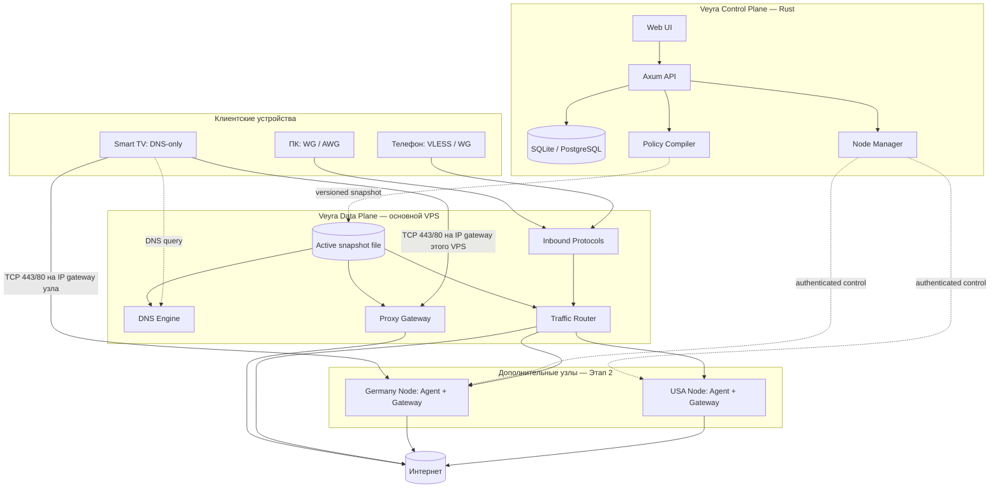
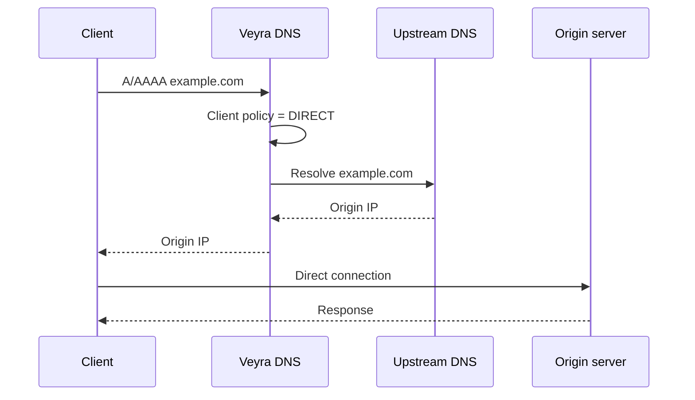
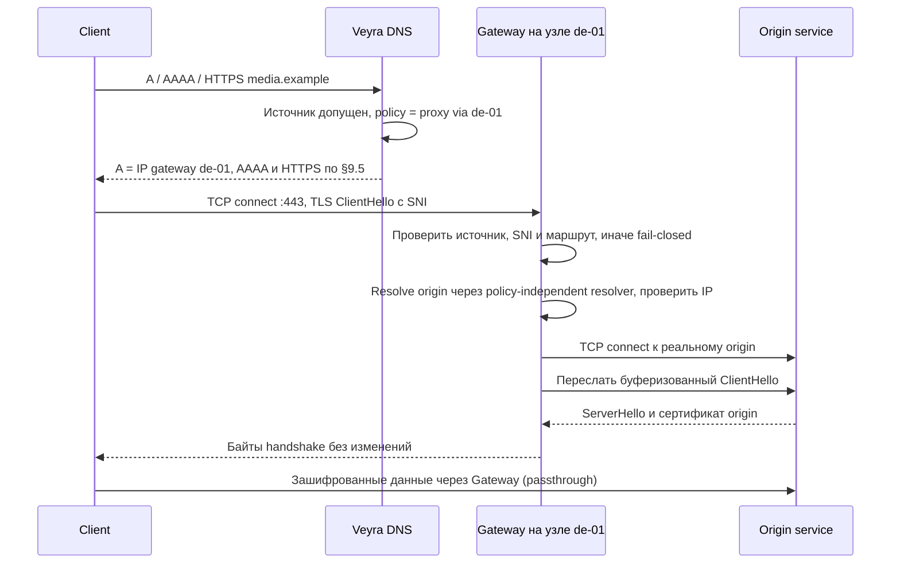
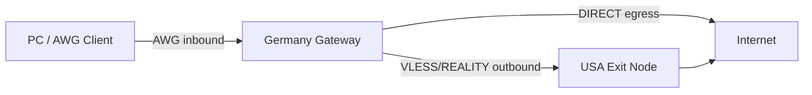
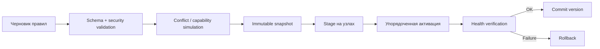

# Veyra — Self-Hosted SmartDNS, Proxy & Multi-Protocol Network Platform

> **Полная концепция, продуктовые требования и техническое задание на разработку**  
> **Язык документа:** русский  
> **Дата:** 12 октября 2026 года  
> **Редакция:** 2 — закрыты замечания архитектурного ревью: режим B, допуск клиентов, модель правил, порядок применения конфигурации, объём MVP  
> **Статус:** архитектурный проект / проектная спецификация, не документация уже реализованного ПО  
> **Предлагаемый основной стек:** Rust + React/TypeScript  
> **Модель распространения:** self-hosted, первоначально Linux VPS; лицензия Veyra ещё не выбрана

---

## Содержание

1. [Концепция и цели](#1-концепция-и-цели)
2. [Основные сценарии использования](#2-основные-сценарии-использования)
3. [Принципиальные технические ограничения](#3-принципиальные-технические-ограничения)
4. [Режимы работы](#4-режимы-работы)
5. [Высокоуровневая архитектура](#5-высокоуровневая-архитектура)
6. [Сетевые потоки: DNS, SmartDNS, туннели](#6-сетевые-потоки-dns-smartdns-туннели)
7. [Мультипротокольная инфраструктура](#7-мультипротокольная-инфраструктура)
8. [Policy Engine и система правил](#8-policy-engine-и-система-правил)
9. [DNS Engine](#9-dns-engine)
10. [Proxy Gateway и маршрутизация](#10-proxy-gateway-и-маршрутизация)
11. [Control Plane, Node Agent и синхронизация](#11-control-plane-node-agent-и-синхронизация)
12. [Веб-панель Veyra](#12-веб-панель-veyra)
13. [Дизайн-система и UX-принципы](#13-дизайн-система-и-ux-принципы)
14. [Подключение устройств и профили](#14-подключение-устройств-и-профили)
15. [Технологический стек Rust](#15-технологический-стек-rust)
16. [Рекомендуемая структура репозитория](#16-рекомендуемая-структура-репозитория)
17. [Предметная модель и схема данных](#17-предметная-модель-и-схема-данных)
18. [API и внутренние контракты](#18-api-и-внутренние-контракты)
19. [Безопасность и приватность](#19-безопасность-и-приватность)
20. [Мониторинг, диагностика и отказоустойчивость](#20-мониторинг-диагностика-и-отказоустойчивость)
21. [Развёртывание и эксплуатация](#21-развёртывание-и-эксплуатация)
22. [Тестирование и критерии качества](#22-тестирование-и-критерии-качества)
23. [Этапы разработки и границы MVP](#23-этапы-разработки-и-границы-mvp)
24. [Критерии готовности и продуктовые решения](#24-критерии-готовности-и-продуктовые-решения)
25. [Риски, компромиссы и открытые вопросы](#25-риски-компромиссы-и-открытые-вопросы)
26. [Глоссарий](#26-глоссарий)
27. [Источники и технические ориентиры](#27-источники-и-технические-ориентиры)

---

## 1. Концепция и цели

### 1.1. Что такое Veyra

**Veyra** — самостоятельно размещаемая платформа управления DNS и маршрутизацией трафика, объединяющая:

- **SmartDNS:** централизованные DNS-политики, условное изменение ответов, выбор upstream-резолвера, кэширование и фильтрацию;
- **Selective Proxy:** выборочное перенаправление совместимых соединений к выходным узлам;
- **VPN / Tunnels:** WireGuard, AmneziaWG и другие туннельные способы подключения устройств;
- **Proxy Protocols:** Xray/VLESS+REALITY, SOCKS5, HTTP CONNECT и впоследствии Shadowsocks, Hysteria 2, TUIC, Trojan;
- **Multi-Node:** несколько VPS и выходных IP, выбор регионов, маршрутов и резервных узлов;
- **Unified Control Plane:** единая веб-панель управления устройствами, профилями, правилами, узлами и статистикой;
- **Diagnostics:** объяснимые решения Policy Engine и сетевые проверки до/после изменения настроек.

Платформа **не сводится к VPN-панели**. Главная идея — дать пользователю управление *тем, какой трафик, от какого клиента, по какой схеме и через какую точку выхода идёт*.

### 1.2. Продуктовая формулировка

> **Veyra — умная маршрутизация без необходимости вручную управлять множеством конфигураций и сервисов.**

При этом продукт не должен скрывать ограничения: DNS-only на телевизоре не даёт тех же возможностей, что установленный VPN-клиент на компьютере.

### 1.3. Целевая аудитория

- Владелец одного домашнего VPS для личного использования.
- Пользователь нескольких устройств (ПК, смартфон, TV, приставка, роутер).
- Пользователь с несколькими географическими точками выхода.
- Технический энтузиаст, которому нужны гибкие DNS- и сетевые политики.
- Небольшая домашняя или лабораторная сеть с управляемыми правилами.

В первоначальном продукте **не ставится цель** создавать публичный коммерческий VPN-сервис, хостинг для чужих пользователей или незакрытый общественный прокси.

### 1.4. Принципы продукта

1. **Self-hosted first:** пользователь владеет инфраструктурой, конфигурациями и ключами.
2. **Rust-native core:** основная собственная серверная логика на Rust.
3. **Protocol agnostic:** общий Control Plane, независимые адаптеры протоколов.
4. **Secure by default:** закрытые endpoints, минимальные привилегии, отказ в опасных конфигурациях.
5. **Transparent routing:** пользователь видит, почему принято решение DIRECT/PROXY/BLOCK.
6. **Capability-aware UX:** панель показывает технически доступные режимы для выбранного устройства и двигателя.
7. **No hidden MITM:** в обычном режиме Veyra не расшифровывает HTTPS и не подменяет сертификаты сайтов.
8. **Safe updates:** некорректное правило не должно ломать существующую рабочую конфигурацию; применение атомарно на уровне компонента, упорядочено и откатываемо (§8.5).
9. **Privacy first:** минимизация хранения DNS-истории и соединений.
10. **Gradual complexity:** один VPS и базовые маршруты сначала, расширенная топология позднее.

### 1.5. Не-цели первой версии

- Гарантированный доступ ко всем сервисам через один изменённый DNS.
- Универсальная маршрутизация QUIC/UDP без туннеля или подходящего клиента.
- Гарантированная незаметность трафика для провайдеров и DPI.
- Автоматический перехват приложений, игнорирующих системный DNS.
- Миграция активных TCP-сеансов без разрыва при смене протокола.
- Собственная новая криптография или собственная реализация всех VPN-протоколов.
- Полноценная мультиарендность, биллинг и массовый пользовательский хостинг.

---

## 2. Основные сценарии использования

### 2.1. Избирательный прокси для конкретных доменов

Пользователь задаёт:

| Цель | Действие | Точка выхода |
|---|---|---|
| `media.example` и необходимые поддомены | PROXY | `de-01` |
| `game.example` | PROXY | `us-01` |
| `bank.example` | DIRECT | не проксируется |
| `ads.example` | BLOCK | нет |
| Всё остальное | DIRECT | согласно типу подключения |

**Важно:** DIRECT означает прямое соединение *от текущего места принятия решения*. В устройстве с локальным split tunneling это может быть домашний интернет; на VPS Gateway DIRECT означает выход в интернет через IP VPS.

В Этапе 1 (single-node) единственная точка выхода — сам VPS; маршруты на `de-01`/`us-01` относятся к Этапу 2 (§23).

### 2.2. Телевизор с настройкой только DNS

- Владелец задаёт IP DNS-сервера Veyra в настройках TV или роутера.
- Публичный IP домашней сети должен быть допущен ACL: роутер периодически вызывает секретный link-IP URL (§9.6). Без этого DNS и Gateway не отвечают.
- Если роутер позволяет, рекомендуемая схема — conditional forwarding: роутер пересылает в Veyra только домены с правилами, остальное разрешает как обычно (§9.7).
- Устройство может пользоваться DNS-кэшем, фильтрацией, обычным разрешением имён.
- Для совместимых TCP/TLS-сервисов возможно перенаправление на SmartDNS gateway.
- Для ECH, HTTP/3, нестандартных портов и приложений с собственным DNS гарантий нет.
- В интерфейсе рядом с профилем TV отображается пометка `DNS-only: limited compatibility`.

### 2.3. Компьютер с полноценным туннелем

- Компьютер подключается к Veyra через WireGuard или AmneziaWG.
- Маршруты определяются на клиенте либо на туннельном шлюзе в зависимости от выбранной топологии.
- Входящий туннель может направить трафик к определённому выходному узлу, в том числе через другой протокол.
- Клиенту можно назначить индивидуальный профиль и DNS-политику.

### 2.4. Разные протоколы на одном узле

Один VPS может обслуживать независимые listener'ы:

- WireGuard — UDP endpoint;
- AmneziaWG — отдельный UDP endpoint;
- Xray с VLESS+REALITY — совместимый TCP endpoint;
- SmartDNS — DNS UDP/TCP и при необходимости DoH/DoT;
- Veyra Admin/API — отдельный HTTPS endpoint (предпочтительно приватный).

Порты и адреса должны назначаться без конфликтов. Не следует обещать, что все перечисленные службы автоматически смогут разделить один `:443`. Решение по умолчанию: единственный владелец TCP/443 — Gateway, который по SNI передаёт DoH и Xray/REALITY локальным сервисам (§21.5); WG, AWG и DNS используют собственные порты.

### 2.5. Межсерверная маршрутизация

Пример: ПК → AWG → Германия → VLESS/REALITY → США → конечный сайт.

Разные протоколы используются на разных сегментах пути. AWG-туннель **завершается** на немецком узле, далее маршрутизируемый трафик отправляется в другой транспорт. Это не конвертация пакетов AWG в VLESS «на лету».

### 2.6. Резервирование

Если приоритетный исходящий узел `us-01` недоступен, Gateway может попробовать `us-02`, а при заданной политике — заблокировать соединение. Для DNS-only перенаправления и активных сессий автоматический fallback имеет ограничения; переключение inbound-протокола требует клиента, умеющего работать с обоими протоколами.

---

## 3. Принципиальные технические ограничения

Это обязательные положения проекта. Их нужно учитывать в архитектуре, тестировании и интерфейсе.

### 3.1. DNS не является VPN

DNS возвращает адрес назначения. Если Veyra выдала настоящий IP сайта, дальнейшее соединение обычно идёт **напрямую от клиента к сайту** и не проходит через Veyra.

Если Veyra выдала адрес собственного proxy gateway, клиент будет подключаться к этому адресу, но корректная переадресация возможна **только при наличии механизма определения исходного назначения** и совместимости протокола.

### 3.2. Ограничение SNI и Encrypted Client Hello

При обычном HTTPS через TCP имя сайта часто присутствует в открытом TLS ClientHello/SNI и может использоваться TCP passthrough-шлюзом для выбора назначения **без расшифровки HTTPS**.

Однако **Encrypted Client Hello (ECH, RFC 9849)** скрывает внутреннее SNI. В таком случае gateway не может надёжно определить реальный домен только по TLS ClientHello. Варианты решения: аутентифицированный клиентский прокси, туннель, выделенные адреса/маршруты для домена или иной явно поддерживаемый механизм. Не следует обещать обход ECH средствами только DNS.

Для доменов с действием PROXY в режиме B DNS Veyra не выдаёт клиенту HTTPS/SVCB-записи (§9.5), поэтому клиент, использующий DNS Veyra, не получает ECHConfig и отправляет обычный SNI. Это не гарантия: клиент с собственным DoH или ранее закэшированной ECH-конфигурацией по-прежнему недоступен для SNI-маршрутизации.

### 3.3. HTTP/3 и QUIC

HTTP/3 использует QUIC/UDP. Простой TCP TLS passthrough не перехватывает его. Удалённый DNS не гарантирует отключение QUIC на клиенте. Поддержка требует UDP-capable транспорта и контролируемой маршрутизации, а в некоторых случаях вообще невозможна в DNS-only режиме.

### 3.4. HTTPS/SVCB DNS-записи

Клиенты могут использовать записи `HTTPS`/`SVCB` (RFC 9460), содержащие информацию об endpoint, ALPN, IP hints, ECH и других параметрах. Ответы `A`/`AAAA` нельзя менять изолированно без анализа последствий: могут появиться альтернативные маршруты и несовместимые подсказки. **Нельзя** бездумно вырезать ECH или HTTPS/SVCB как «универсальное исправление». Удаление допускается только адресно — для доменов, которые пользователь явно направил через gateway; точные правила синтеза ответов — §9.5.

### 3.5. DNSSEC

Изменение подписанного DNS-ответа может сделать его недействительным для валидирующего клиента. Нельзя выдавать переписанные ответы за подлинные DNSSEC-подписанные данные. В интерфейсе и тестах должна существовать чёткая граница между *обычным верифицируемым разрешением* и *локальным policy override*.

### 3.6. DNS обходится приложением

Браузер или приложение может использовать собственный DoH/DoT, встроенные IP-адреса, локальные кэши или CDN. Смена DNS на устройстве не обеспечивает 100% контроль всего трафика. Полный контроль возможен только при достаточном уровне управления конечным клиентом или роутером.

### 3.7. Идентификация при NAT

В DNS-пакете нет универсального идентификатора, автоматически переносимого в последующее HTTPS/TCP-соединение. Несколько устройств за одним NAT могут иметь общий внешний IP. Поэтому индивидуальные политики **нельзя надёжно связывать с proxy-трафиком только по IP клиента**, если отсутствуют дополнительные идентификаторы/выделенные маршруты.

### 3.8. Прочие ограничения

- Общие IP и CDN могут обслуживать десятки доменов: нельзя считать IP эквивалентом конкретного сервиса.
- TLS certificate pinning и нестандартные протоколы могут нарушать совместимость с промежуточными шлюзами.
- Геодоступность зависит не только от IP выхода, но также от аккаунта, cookies, платежных данных и проверок сервиса.
- Изменение DNS-правила не меняет немедленно все соединения: действуют TTL, внутренние кэши ОС и существующие сессии.
- IPv4 и IPv6 должны подчиняться согласованным правилам, иначе возможен обход политики.
- Серверный Gateway, выбирающий DIRECT, не возвращает трафик автоматически к домашнему IP клиента.

---

## 4. Режимы работы

### 4.1. Режим A — DNS Resolver / Policy DNS

**Назначение:** кэш, фильтры, conditional upstream, локальные записи и DIRECT/BLOCK-политики.

Путь: `Client → Veyra DNS → Upstream resolver → DNS response`. При обычном разрешении клиент подключается к сайту напрямую.

**Плюсы:** минимум настройки, подходит многим устройствам. **Ограничение:** не меняет маршрут трафика без отдельного proxy gateway.

### 4.2. Режим B — SmartDNS + TCP Passthrough

**Назначение:** выборочное перенаправление *совместимых* TCP/TLS-соединений.

Условия применения:

1. Устройство действительно использует DNS Veyra.
2. Выбранный домен поддерживается Gateway и политикой.
3. Gateway способен установить разрешённое исходящее соединение к нужному origin.
4. Исходный домен однозначно установлен (например, доступный SNI либо выделенный route context).
5. Клиент принимает конечный сертификат **реального сайта**; Veyra не подменяет его.
6. Кэш, HTTPS/SVCB, IPv6 и альтернативные протоколы учтены.
7. Источник запроса допущен ACL (CIDR, link-IP, DDNS или токен DoT/DoH, §9.6).
8. Соединение идёт на обслуживаемый порт: TCP 443 (TLS, выбор по SNI) или TCP 80 (HTTP, выбор по `Host`). Прочие порты получают немедленный RST.

**Ограничение:** не универсален для ECH, QUIC, произвольных портов и некоторых приложений.

### 4.3. Режим C — Explicit Proxy

**Назначение:** устройство или приложение явно настроено на SOCKS5 / HTTP CONNECT либо совместимый защищённый прокси.

- Клиент сообщает целевое назначение через стандартный протокол прокси.
- Возможна аутентификация и привязка к профилю.
- Менее двусмысленная маршрутизация, чем у DNS-only.
- Совместимость UDP зависит от конкретного протокола и клиента.

### 4.4. Режим D — Full Tunnel

**Назначение:** клиент маршрутизирует свой трафик через WireGuard, AmneziaWG или другой TUN-capable движок.

- Можно строить full tunnel или split tunnel, если клиент/роутер поддерживает нужные правила.
- Разрешается маршрутизация по IP, протоколу, CIDR и, если доступно, доменным политикам.
- Прозрачная маршрутизация требует работы с политиками ОС, таблицами маршрутизации, DNS и иногда nftables/TProxy.

### 4.5. Сравнительная матрица

| Возможность | DNS-only | DNS + TCP gateway | Explicit proxy | Full tunnel |
|---|---:|---:|---:|---:|
| DNS-фильтрация | Да | Да | При интеграции DNS | Да, если DNS через Veyra |
| Изменение IP выхода для выбранного трафика | Нет | Частично | Да, в поддерживаемых приложениях | Да, по маршрутам |
| Поддержка TCP HTTPS | DNS-решение | Совместимые соединения | Да | Да |
| Надёжная работа с ECH без SNI | Не гарантирована | Не гарантирована | Да, при явном destination | Да, при доступной маршрутизации |
| UDP / QUIC | Не маршрутизует | Не гарантировано | Зависит от протокола | Да, при корректном туннеле |
| Требуется клиент | Обычно нет | Обычно нет, но совместимость ограничена | Часто да/системная настройка | Да/на роутере |
| Точный client identity | Ограниченно | Ограниченно | Через credentials | Через peer/credentials |

---

## 5. Высокоуровневая архитектура

### 5.1. Разделение Control Plane и Data Plane

**Control Plane** отвечает за сущности, правила, пользователей, профили, регистрацию узлов, аудит, резервные копии и публикацию версий конфигурации.

**Data Plane** отвечает за фактическую обработку DNS, TCP/UDP, VPN-интерфейсов и прокси-трафика. Он **обязан продолжать работу по последней валидной конфигурации**, даже если панель управления/БД временно недоступны.



Схема логическая: **DNS Engine не пропускает через себя пользовательский трафик** — он только выбирает, какой IP вернуть. В режиме B клиент сам подключается к gateway того узла, чей IP получил в ответе (основной VPS или exit-узел, §10.2). DNS, Gateway и Router читают активный snapshot из локального файла и не зависят от БД во время работы (§5.3).

### 5.2. Рекомендуемые сервисы

| Сервис | Ответственность | Язык |
|---|---|---|
| `veyra-server` | Control API, админка, конфигурации | Rust |
| `veyra-dns` | DNS listeners, resolver, policy DNS | Rust |
| `veyra-gateway` | TCP proxy, route decisions, dispatch | Rust |
| `veyra-agent` | На удалённых VPS: протоколы, health, метрики | Rust |
| `veyra-policy` | Правила, компиляция, конфликты, simulate | Rust |
| `veyra-protocols` | Стандартизованные adapters | Rust |
| `veyra-web` | Панель администратора | TypeScript/React |
| `xray` / `sing-box` / `wg` / `awg` | Независимые сетевые движки | Внешние компоненты |

Для одного VPS эти логические сервисы можно объединить в небольшое число процессов/контейнеров. Не создавать микросервисную инфраструктуру ради микросервисов.

Рекомендуемая топология MVP — два процесса: `veyra-server` (API, UI, Policy Compiler) и `veyra-dataplane` (DNS + Gateway). Падение или перезапуск `veyra-server` не останавливает обработку DNS и соединений.

### 5.3. Принцип независимости компонентов

- DNS и Gateway читают подготовленный **versioned policy snapshot**.
- Активный snapshot хранится локально как файл (запись через временный файл + `rename`); DNS и Gateway загружают его при старте и не обращаются к БД на горячем пути. О новой версии `veyra-dataplane` узнаёт через локальный Unix-сокет управления (`stage`, `activate`, `rollback`, `status`); через него же `veyra-server` или CLI выполняют упорядоченное применение и шаг VERIFY (§8.5).
- Node Agent не зависит от работающего браузерного интерфейса.
- Протокольные процессы могут перезапускаться независимо.
- Отказ Xray не должен останавливать WireGuard или DNS.
- Компоненты с повышенными привилегиями изолированы от публичного HTTP API.

---

## 6. Сетевые потоки: DNS, SmartDNS, туннели

### 6.1. Обычное DNS-разрешение (DIRECT)



### 6.2. Совместимое SmartDNS → TLS passthrough



**Ключевые условия:** origin определяется **однозначно**; Gateway не является открытым произвольным TCP-connect-сервисом; SNI нельзя использовать, когда ECH скрывает фактический хост; DNS-ответы и gateway route должны соответствовать друг другу; origin resolve не должен зациклиться через тот же policy DNS. На TCP 80 тот же поток работает по заголовку `Host`; прочие TCP-порты IP gateway получают RST, а UDP/443 отклоняется, чтобы клиент быстро переходил с HTTP/3 на TCP (§10.1).

### 6.3. Полный туннель и выход через другой сервер



После получения пакетов из AWG-интерфейса Veyra обрабатывает их согласно правилам. Перенаправление в VLESS обеспечивается поддерживаемой network stack / TUN / proxy-маршрутизацией. Это отдельная инженерная задача: соединить сетевой туннель с proxy engine, а не простая запись одной строки в конфигурации.

### 6.4. Действия: маршрут и DNS — отдельные измерения

Решение политики состоит из двух независимых полей.

**Маршрутное действие (`route`)** — куда идёт трафик:

- `DIRECT`: выход из текущей точки;
- `BLOCK`: отказ по политике;
- `PROXY_NODE`: выбор фиксированного удалённого выхода;
- `NODE_GROUP`: выбрать доступный узел в группе;
- `OUTBOUND`: назначить конкретный локальный protocol outbound.

**DNS-действие (`dns`)** — что получает клиент на DNS-запрос:

- `RESOLVE`: обычное разрешение через upstream group по умолчанию или указанную (`upstreamGroup`); выбор resolver **не** выбирает egress;
- `LOCAL_OVERRIDE`: фиксированные локальные записи без автоматического проксирования;
- `BLOCK`: синтезированный блокирующий ответ (§9.5); в DNS-режимах выводится из `route: BLOCK`;
- `GATEWAY`: синтезированный ответ с IP gateway; **не задаётся вручную**, а выводится компилятором из `route: PROXY_NODE / NODE_GROUP` для режима B.

Бессмысленные комбинации (например, `route: PROXY_NODE` + `dns: LOCAL_OVERRIDE` в режиме B) отклоняются при валидации.

---

## 7. Мультипротокольная инфраструктура

### 7.1. Inbound и Outbound

- **Inbound:** как трафик **попадает** в Veyra (WG peer, AWG peer, VLESS listener, SOCKS5, TUN, DNS proxy entry).
- **Outbound:** как он **покидает** Veyra (DIRECT, WireGuard egress, VLESS/REALITY egress, SOCKS5/HTTP, другой Node).
- **Engine:** исполняемая реализация (WireGuard в Linux, AWG kernel/userspace, Xray-core, sing-box).
- **Adapter:** Rust-компонент, который управляет engine, проверяет поддержку и жизненный цикл.

Различать протокол и движок: **Xray — движок, а VLESS+REALITY — комбинация протокола и transport/security layer.**

### 7.2. Рекомендуемая матрица интеграции

| Технология | Тип | Реализация | Примечания |
|---|---|---|---|
| WireGuard | VPN/TUN | kernel WG + Rust adapter | Основной простой tunnel |
| AmneziaWG | VPN/TUN | официальный AWG + Rust adapter | Параметры/версии согласовать с клиентом; kernel-модуль через DKMS ломается при обновлении ядра — userspace `amneziawg-go` как fallback |
| Xray VLESS+REALITY | Proxy | Xray-core + Rust adapter | Контроль версии и совместимости |
| sing-box | Multi-protocol engine | внешний engine + Rust adapter | Не считать заменой AWG |
| SOCKS5 | Explicit proxy | нативный Rust или engine | Авторизация, ограничение destinations |
| HTTP CONNECT | Explicit proxy | нативный Rust или engine | Доступ только авторизованным клиентам |
| Shadowsocks | Proxy | sing-box / иной поддерживаемый engine | Позднее |
| Hysteria 2 | QUIC-based proxy | sing-box / самостоятельный engine | Позднее |
| TUIC | QUIC proxy | sing-box / иной engine | Позднее |
| Trojan | TLS proxy | Xray или sing-box | Позднее |
| OpenVPN | VPN | внешний engine | Низкий приоритет |

**Важная оговорка:** матрица показывает *проектируемые интеграции*, а не подтверждает, что любой engine поддерживает любую комбинацию inbound/outbound и UDP без ограничений. Совместимость требуется фиксировать по конкретным версиям.

### 7.3. Capability model

Адаптер должен объявлять фактические capabilities, например:

```yaml
# Схематический пример, не готовая конфигурация движка
engine: xray-core
engine_version: "<detected-at-runtime>"
features:
  inbound: true
  outbound: true
  tcp: true
  udp: "depends_on_transport"
  tun: false
  per_client_credentials: true
  hot_reload: "partial_or_restart"
  metrics: "adapter_specific"
  config_export: ["vless_uri", "native_json"]
```

Если capability неизвестна, считать её отсутствующей до проверки. Не создавать фиктивный универсальный переключатель `supports_everything: true`.

### 7.4. Интерфейс адаптера (псевдо-Rust)

```rust
// Архитектурный эскиз, не готовый компилируемый модуль.
#[async_trait::async_trait]
pub trait ProtocolAdapter: Send + Sync {
    fn engine_id(&self) -> &'static str;
    async fn detect(&self) -> Result<EngineCapabilities, AdapterError>;
    async fn validate(&self, plan: &ProtocolPlan) -> Result<(), AdapterError>;
    async fn prepare(&self, plan: &ProtocolPlan) -> Result<PreparedConfig, AdapterError>;
    async fn apply(&self, prepared: &PreparedConfig) -> Result<ApplyResult, AdapterError>;
    async fn health(&self) -> Result<EngineHealth, AdapterError>;
    async fn stop(&self, instance_id: &str) -> Result<(), AdapterError>;
}
```

Дополнительные методы для `add_peer`, `revoke_peer`, `rotate_credentials`, `export_client_config`, `collect_metrics` могут быть отдельными traits или опциональными capabilities. Не считать добавление peer и динамический reload одинаковыми для всех протоколов.

### 7.5. Управление процессами

- Бинарник движка проверен по происхождению и контрольной сумме.
- Версия **закреплена**; обновление через контролируемый workflow.
- Все секреты передаются безопасно; не попадают в аргументы процессов, логи или общий temp.
- Конфигурация валидируется *до* замены действующей.
- Движок работает под отдельным непривилегированным пользователем, если это возможно.
- Ограничены CPU/memory/file descriptors, применяются restart policies.
- Нарушение работы одного адаптера не приводит к перезапуску всех других.

### 7.6. Автоматический выбор протокола

В будущем возможен `Connection Strategy`: первичный и резервный inbound/outbound, критерии деградации, cooldown, health-based переключение.

Однако:

- Переключать **outbound** может серверный Gateway.
- Переключение **inbound** с WG/AWG на VLESS требует клиентского программного обеспечения, которое умеет переключаться.
- В большинстве случаев текущие TCP-сессии прерываются при смене маршрута.
- Нельзя включать fail-open на прямой маршрут по умолчанию для политик, требующих строго определённый egress.

---

## 8. Policy Engine и система правил

### 8.1. Общие требования

Policy Engine — один из ключевых собственных компонентов Veyra. Он должен быть **детерминированным, тестируемым, объяснимым и не привязанным к протоколу**.

Предлагаемые классы правил:

- exact FQDN (`example.com`) — только само имя;
- subdomain wildcard (`*.example.com`) — любые поддомены, **без** apex `example.com`;
- suffix (`suffix:example.com`) — apex и все поддомены;
- service group (`streaming-global`);
- CIDR / IP prefix для туннельных маршрутов;
- protocol/port match там, где источник метаданных известен;
- device/profile scope;
- явные allow/block exceptions.

Запросы домена должны нормализоваться (lowercase, IDNA/punycode, trailing dot). Другие формы шаблонов (regex, keyword) в MVP не поддерживаются.

### 8.2. Порядок принятия решения

1. Определить source identity и доверенность атрибутов (device, peer, proxy credentials, DNS profile).
2. Выбрать применяемый профиль (IP-источник соответствует ровно одному профилю, §17.2).
3. Нормализовать query/destination.
4. Найти подходящие правила.
5. Разрешить конфликты по фиксированному порядку старшинства (§8.2.1).
6. Проверить **capabilities** и доступность маршрута.
7. Применить действие или заранее заданную failure policy.
8. Зафиксировать rule ID, config version и reason code для diagnostics.

**Не использовать случайный порядок из HashMap.**

#### 8.2.1. Порядок старшинства правил

1. **Специфичность совпадения.** Exact FQDN > шаблон с бо́льшим числом меток > шаблон с меньшим числом меток. Для имени `a.example.com` шаблоны `*.example.com` и `suffix:example.com` равны по специфичности. Для CIDR — более длинный префикс. Если домен известен, доменные правила рассматриваются раньше CIDR; CIDR-правила применяются, когда домен неизвестен или ни одно доменное правило не совпало.
2. **Специфичность scope.** `device` > `profile` > `default`.
3. **Действие.** `BLOCK` > `PROXY_NODE` / `NODE_GROUP` / `OUTBOUND` > `DIRECT`.
4. **Финальный tie-breaker:** лексикографический порядок `rule id`.

Числового `priority` в MVP нет: при порядке «priority first» широкое правило молча перекрывает точное исключение. Исключение задаётся более точным шаблоном (`login.media.example: DIRECT` поверх `suffix:media.example: PROXY`). Чтобы переопределить исключение для конкретного устройства, создаётся правило с тем же шаблоном в scope `device`.

Валидатор возвращает:

- **ошибку** — одинаковый шаблон, одинаковый scope, разные действия или цели;
- **предупреждение** — правило полностью затенено другим и никогда не срабатывает;
- **предупреждение** — конфликт решён только шагом 3 или 4.

### 8.3. Схематический пользовательский YAML

```yaml
# ИЛЛЮСТРАТИВНЫЙ формат Veyra, не рабочий конфиг установленного сервиса.
# PolicyBundle — формат импорта/экспорта набора правил, а не отдельная сущность БД.
apiVersion: veyra.io/v1alpha1
kind: PolicyBundle
metadata:
  name: home-default
spec:
  profiles:
    - id: home
      defaultAction: direct
  rules:
    - id: video-through-germany
      enabled: true
      scope: { profile: home }
      match:
        domains: ["suffix:media.example"]
      action:
        type: proxy_node
        node: de-01
        onFailure: block
      modesAllowed: ["smartdns_tcp", "explicit_proxy", "tunnel"]
    - id: media-login-direct            # exact сильнее suffix (§8.2.1)
      enabled: true
      scope: { profile: home }
      match:
        domains: ["login.media.example"]
      action:
        type: direct
    - id: work-resolver
      enabled: true
      scope: { device: work-laptop }
      match:
        domains: ["suffix:corp.example"]
      dns:
        upstreamGroup: corp             # выбор resolver, не egress (§6.4)
      action:
        type: direct
    - id: block-ads
      enabled: true
      scope: default
      match:
        domains: ["suffix:ads.example"]
      action:
        type: block
```

Правило принадлежит ровно одному scope: `default`, профилю или устройству. Профиль задаёт `defaultAction`; отдельного «пользовательского» scope нет — `User` в модели означает администратора (§17.1).

Рабочий пример с разделами `nodes` и `devices`, на которые ссылаются правила, — `configs/examples/home.yaml`; проверка — `veyra validate`.

### 8.4. Rule Tester / Explain

На вход: `client`, `profile`, `domain` или `destination`, `protocol`, `port`, `mode`, `config version`.

На выход: совпавшее правило, действие, возможный выходной узел, наличие ограничений, последовательность причин и предупреждений. **Rule Tester предсказывает policy decision, но не гарантирует реальную сетевую успешность**; отдельный Network Test должен выполнить фактическое соединение.

### 8.5. Компиляция и применение



- Конфигурации имеют монотонную версию/hash.
- Обновление сначала проходит синтаксические, семантические и security-проверки.
- Атомарность обеспечивается **на уровне компонента**: DNS и Gateway переключают snapshot одной заменой указателя (`ArcSwap` или эквивалент); движки получают конфигурацию через временный файл + `rename` + штатный reload/restart. Атомарная активация всего узла (DNS + ядро WG + процесс Xray) невозможна, поэтому узел применяет компоненты **в фиксированном порядке** и при ошибке выполняет компенсирующий откат уже применённых компонентов. После завершения apply или rollback узел не остаётся в смешанном состоянии.
- Порядок для режима B:
  - **добавление или изменение маршрута:** сначала Gateway (начинает принимать новый SNI/`Host`), затем DNS (начинает выдавать IP gateway);
  - **удаление маршрута:** сначала DNS перестаёт выдавать IP gateway, затем Gateway — не раньше окончания `drain_window`; до этого Gateway обслуживает удалённый маршрут по предыдущему snapshot, чтобы клиенты с закэшированным ответом не получали отказ. Если новое действие — `BLOCK`, drain не нужен: отказ соединения и есть желаемый результат.
- `drain_window` по умолчанию 10 минут и не может быть меньше максимального TTL синтезированных ответов (§9.5): ОС и TV часто держат кэш дольше TTL.
- Шаг VERIFY проверяет: DNS отвечает на canary-запрос по каждому listener ответом новой версии; Gateway слушает все объявленные endpoints; каждый изменённый движок проходит health уровня 2 (§20.2). Невыполнение любого пункта — rollback.
- На несколько узлов изменения применяются с контролем их статуса; возможное временное расхождение явно отображается.
- Rollback возвращает предыдущие конфиги, но **не обещает** восстановление уже разорванных сессий.

---

## 9. DNS Engine

### 9.1. Задачи

- Слушать DNS UDP/TCP 53 и отвечать только допущенным источникам (§9.6).
- Синтезировать ответы для BLOCK и PROXY строго по таблице §9.5.
- При необходимости предоставлять DoT 853, DoH через выделенный HTTPS endpoint.
- Forward resolver к доверенным upstream (для MVP предпочтительно перед собственной рекурсией).
- Кэшировать результаты с учётом TTL и границ профилей.
- Поддерживать A, AAAA, CNAME, TXT, HTTPS, SVCB и необходимые служебные типы.
- Предоставлять локальные override records, allow/block lists.
- Выполнять DNS policy без смешения этого решения с реальной proxy routing.
- Экспортировать показатели hit/miss, latency, SERVFAIL, NXDOMAIN, upstream health.

### 9.2. Rust-подход

Использовать **Hickory DNS** (`hickory-server`, `hickory-resolver` и связанные crates), Tokio, rustls. У Hickory есть серверные и резолверные библиотеки, DNSSEC и optional DoT/DoH/DoQ; необходима фиксация совместимых версий и Cargo features. Собственный `veyra-dns` содержит policy-слой поверх используемых библиотек.

### 9.3. Кэш

Ключ кэша учитывает: нормализованное имя, тип запроса, класс, upstream group и подсеть ECS (если ECS включён, §9.7). Кэшируются только ответы upstream; синтезированные ответы (§9.5) вычисляются из policy на каждый запрос и в общий кэш не попадают. **Не следует** допускать утечки изменённого ответа одного профиля в другой профиль через общий кэш. Для DNSSEC сохранять границы валидируемых и локально переписанных ответов.

### 9.4. Безопасные DNS overrides

- Нельзя выдавать произвольный публично доступный gateway IP для несовместимых доменов.
- Для SmartDNS TCP gateway — фиксировать route mapping, совместимость и предсказуемую политику отказа.
- IPv4/IPv6 и HTTPS/SVCB обрабатываются по единой таблице §9.5.
- Никакой автоматической подмены подписанных ответов с сохранением признака валидности.
- Правила upstream нельзя использовать для DNS-рекурсивной петли.
- Любые local records и blocklists проходят проверку на wildcard explosions, избыточные маски и конфликты.

### 9.5. Синтез ответов по действию политики

Ответ определён заранее для каждой пары «тип запроса × действие». Колонка «PROXY (режим B)» применяется, только если правило разрешает `smartdns_tcp`, а источник допущен (§9.6).

| Тип запроса | DIRECT / RESOLVE | BLOCK | PROXY (режим B) |
|---|---|---|---|
| `A` | Ответ upstream | `0.0.0.0` | IP gateway выбранного exit-узла |
| `AAAA` | Ответ upstream | `::` | IPv6 gateway, если он есть; иначе NODATA. **Никогда** не AAAA origin |
| `HTTPS` (65) / `SVCB` (64) | Ответ upstream без изменений | NODATA | NODATA |
| `CNAME`-цепочка | Как вернул upstream | Не раскрывается | Не раскрывается: синтезированный `A`/`AAAA` выдаётся прямо на имя запроса |
| Прочие типы (`MX`, `TXT`, …) | Ответ upstream | NODATA | Ответ upstream (на маршрут не влияют) |

Правила:

- **NODATA** — `NOERROR` с пустой секцией ответа и синтезированной SOA в authority, у которой и TTL записи, и `minimum` равны `synth_ttl` (negative TTL — меньшее из двух, RFC 2308): negative caching длится не дольше TTL синтезированных ответов.
- **BLOCK по умолчанию — `0.0.0.0` / `::`**, а не NXDOMAIN: соединение завершается сразу, а NXDOMAIN кэшируется по SOA и провоцирует часть клиентов обращаться к резервным резолверам. Профиль может переключить BLOCK на NXDOMAIN.
- **TTL синтезированных ответов** (`synth_ttl`): по умолчанию 60 с, допустимый диапазон 30–300 с. Короткий TTL нужен для failover и смены правил.
- **HTTPS/SVCB для PROXY-доменов подавляются целиком.** В них содержатся `ipv4hint`/`ipv6hint` реального origin (обход gateway) и `ech` (gateway увидит outer SNI вроде `cloudflare-ech.com` и откажет по fail-closed). Это адресное удаление ECH только для доменов, которые пользователь сам направил через gateway; для DIRECT-доменов записи не меняются. Синтез собственной HTTPS-записи без hints и `ech` — после MVP.
- **Правила сопоставляются только с именем запроса.** Сопоставление с целями CNAME (например, для блокировки CNAME-cloaking трекеров) — отдельная опция после MVP.
- **DNSSEC:** синтезированные ответы всегда с `AD=0` и без RRSIG, даже при `DO=1` в запросе.
- **Отказ exit-узла** (`onFailure`): `block` — BLOCK-ответ; `fallback_node` — IP gateway резервного узла; `direct` — обычное разрешение, только если явно разрешено (§13.3).

### 9.6. Допуск клиентов и идентификация

DNS (UDP/TCP 53) и passthrough Gateway (режим B) отвечают только допущенным источникам. Недопущенный UDP-запрос **молча отбрасывается** (без REFUSED, чтобы не участвовать в reflection); TCP-соединение закрывается.

Каналы с собственной аутентификацией — DoT, DoH, link-IP и REALITY — принимают соединения с любых IP: допуском для них служит токен или UUID. DoT с неизвестным токеном в SNI прерывается на TLS handshake; DoH и link-IP с неизвестным токеном получают `404`.

| Способ | Для каких клиентов | Что идентифицирует |
|---|---|---|
| Статическая сеть / CIDR | Частные сети, WG-интерфейс, известные статические IP | Сеть → профиль |
| **Link-IP** | Smart TV, приставки, любые DNS-only устройства за домашним NAT с динамическим IP | Текущий публичный IP сети → профиль |
| DDNS-имя | Роутеры, уже обновляющие DDNS | Veyra периодически разрешает имя и обновляет ACL |
| DoT с токеном в SNI (`<token>.dns.<домен>`) | Android Private DNS, DoT-клиенты | Конкретное устройство независимо от IP |
| DoH с токеном в пути (`/dns-query/<token>`) | iOS/macOS (профиль конфигурации), браузеры, Windows | Конкретное устройство независимо от IP |

**Link-IP.** Профилю выдаётся секретный токен. Роутер (cron + `curl`/`wget`) или пользователь вручную вызывает `https://link4.dns.<домен>/link/<token>` (у имени только A-запись), а в dual-stack сети также `https://link6.dns.<домен>/link/<token>` (только AAAA): вызов регистрирует адрес только того семейства, по которому пришёл. Veyra записывает IP источника вызова в ACL на ограниченный срок (по умолчанию 7 дней, продлевается каждым вызовом). IPv4 допускается как `/32`, IPv6 — как `/64`, потому что устройства домашней сети получают разные адреса из одного префикса. Новый адрес вытесняет предыдущий адрес того же семейства для этого токена. Endpoint обрабатывается внутри `veyra-dataplane`: gateway передаёт принятый сокет локальному HTTPS-обработчику без проксирования, поэтому IP источника сохраняется (§21.5). Вызовы ограничены по частоте; токен выпускается и отзывается из панели или CLI.

**Токены DoT/DoH.** DoT требует wildcard-сертификат `*.dns.<домен>`, поэтому нужен ACME DNS-01. Токен — случайный идентификатор не короче 128 бит; он не даёт доступа к панели и отзывается отдельно. DoT-токен передаётся в SNI **открытым текстом** и виден наблюдателю на пути, а DoH-токен находится в зашифрованном пути URL. Поэтому DoT-токен всегда выбирает профиль, но допускает IP к Gateway (ниже) только при явном включении в профиле; DoH-токен допускает по умолчанию.

**Привязка к профилю.** Один IP-источник (CIDR, link-IP, DDNS) соответствует ровно одному профилю; пересекающиеся IP-привязки разных профилей отклоняются валидатором (§17.2). Link-IP и DDNS идентифицируют **сеть**, а не устройство: все устройства за этим NAT получают один профиль. Различать устройства за одним NAT можно только токенами DoT/DoH.

**Gateway использует тот же ACL.** Соединения режима B допускаются только от источников, допущенных CIDR, link-IP или DDNS. Успешный DoH-запрос с токеном (DoT — только если включено в профиле) временно, на `drain_window`, допускает IP источника и для Gateway (IPv6 — как `/64`); иначе устройство с токеном не сможет подключиться к выданному IP. За CGNAT это допускает и соседей по общему IP; экспозиция ограничена доменами режима B этого узла и сроком допуска.

### 9.7. Геолокация CDN и EDNS Client Subnet

Upstream и авторитетные серверы CDN видят адрес VPS, а не клиента. Пользователь в одной стране, разрешающий DIRECT-домены через VPS в другой, получает CDN-узлы рядом с VPS — для **всего** DIRECT-трафика, а не только проксируемого. Кроме того, каждый промах кэша добавляет RTT до VPS.

1. **ECS по умолчанию выключен:** upstream не получает подсеть клиента.
2. **ECS opt-in на уровне upstream group:** передаётся усечённая подсеть клиента (`/24` IPv4, `/56` IPv6); подсеть входит в ключ кэша (§9.3).
3. **Рекомендуемая домашняя схема — conditional forwarding на роутере.** Роутер разрешает всё через обычный DNS и пересылает в Veyra только домены, для которых есть правила PROXY или BLOCK. Veyra экспортирует готовый фрагмент конфигурации (dnsmasq/OpenWrt, AdGuard Home; другие форматы — позже). Плюсы: нет лишней задержки и искажения CDN для остальных доменов, меньше внешней поверхности. Минусы: DNS-фильтрация Veyra действует только на пересылаемые домены, и фрагмент нужно переэкспортировать после изменения правил.

### 9.8. DNS dashboard

Настройки: listeners, upstream groups, ECS, cache, local records, block/allow lists, DNSSEC policy, допуск клиентов (CIDR, link-IP, DDNS, токены), security, запросы, hit ratio, p50/p95 latency, health of upstream resolvers.

---

## 10. Proxy Gateway и маршрутизация

### 10.1. Роли Gateway

- Accept TCP-соединений на обслуживаемых портах IP gateway: **443** (TLS, назначение по SNI) и **80** (HTTP, назначение по заголовку `Host`; запрос не изменяется, заголовки только буферизуются для чтения `Host`).
- Немедленный TCP RST на портах IP gateway, не занятых другими службами: клиент должен сразу получить ошибку, а не ждать таймаута.
- UDP/443 на IP gateway **отклоняется** (ICMP / ICMPv6 port unreachable), а не отбрасывается молча: клиент, узнавший HTTP/3 через `Alt-Svc`, быстро возвращается к TCP. Поэтому QUIC-протоколы (Hysteria 2, TUIC) не могут занимать UDP/443 на IP gateway.
- Проверка источника по общему с DNS ACL (§9.6).
- Определение destination по *разрешённому и достоверному* контексту.
- Применение policy версии, действовавшей на момент route decision.
- Установление соединения к origin или outbound engine.
- Bidirectional byte forwarding при TLS passthrough **без завершения TLS**.
- Limits: concurrent sessions, idle timeout, quotas, ingress/egress rate.
- Защита от SSRF, внутренних/loopback/metadata адресов и DNS rebinding.
- Сбор агрегированных метрик соединений.

### 10.2. Destination binding

Одного SNI недостаточно для разрешения произвольного доступа. Gateway должен сопоставлять запрос с поддерживаемым сервисом, разрешёнными target domains, профилем, маршрутом и, где возможно, origin resolver. При неизвестном или неоднозначном destination — fail-closed.

Варианты:

1. **Dedicated gateway IP per route/service:** более однозначно, но потребляет адреса.
2. **SNI-based TCP passthrough:** экономит адреса, но конфликтует с ECH, несоответствием SNI и некоторыми сценариями.
3. **Explicit proxy / tunnel:** клиент передаёт destination в доверенном канале, более надёжно.

**Размещение gateway — на каждом exit-узле.** DNS возвращает IP gateway, работающего на том узле, через который должен выйти трафик; соединение идёт «клиент → gateway узла → origin» без промежуточного hop через основной VPS. Следствия:

- IP в ответе DNS сам кодирует маршрут — это вариант 1 без выделения IP на каждый сервис;
- в Этапе 1 это единственный VPS; в Этапе 2 каждый узел запускает gateway через Agent;
- failover выполняет DNS: при недоступности gateway узла выдаётся IP gateway резервного узла (с задержкой до `synth_ttl`).

**Gateway различает только `(listen IP, порт, SNI/Host, источник)`.** Профилей он не видит: gateway узла пропускает объединение доменов всех профилей, направленных на этот узел, от всех допущенных источников. Различия между профилями обеспечивает DNS (какой IP gateway выдать), поэтому они работают только там, где DNS однозначно определяет профиль (§9.6).

### 10.3. Исходящий DNS

Gateway должен разрешать *origin* через доверенный policy-independent resolver, чтобы не получить собственный gateway IP вместо реального сервера и не создать петлю. DNS re-resolution допускается при TTL/смене сервиса, но каждый новый target проверяется повторно на запрещённые сети.

### 10.4. Маршрутизация к движкам

В зависимости от протокола Gateway может:

- подключаться к локальному SOCKS5/HTTP/compatible proxy endpoint;
- передавать трафик через TUN/network interface;
- использовать route manager и таблицы Linux;
- отправлять поток на другой Node по защищённому каналу.

Не все комбинации `TCP/UDP × engine × inbound × outbound` автоматически доступны. Выбор маршрута обязательно проверяет capability matrix.

### 10.5. TCP/UDP и масштабирование

Начать с TCP. UDP/QUIC реализовывать отдельным направлением, с явной state table/timeout/flow identity и защитой от amplification. Для производительности учитывать connection pooling (где протокол позволяет), backpressure, сокеты, allocation profile, copy paths и лимиты файловых дескрипторов.

---

## 11. Control Plane, Node Agent и синхронизация

### 11.1. Control Plane

Содержит:

- API + RBAC;
- базу данных конфигураций;
- Node Registry;
- Policy Compiler;
- Secret Manager interface;
- сервис версионирования и аудита;
- migration/backup management;
- UI backend.

### 11.2. Node Agent

Rust-бинарник на VPS, который:

1. Регистрируется по краткоживущему одноразовому enrollment token.
2. Устанавливает взаимно аутентифицированный защищённый канал с Control Plane (mTLS или другой сопоставимый механизм).
3. Отправляет capabilities, версию OS/kernel, статус interfaces/ports и health.
4. Получает подписанные либо аутентифицированные конфигурационные snapshots.
5. Валидирует и применяет их локально.
6. Управляет процессами WireGuard/AWG/Xray/sing-box через adapters.
7. Собирает агрегированные метрики, не раскрывая credentials.
8. Переживает потерю Control Plane, используя last-known-good.
9. Запускает gateway узла для режима B и сообщает его health, по которому DNS выполняет failover (§10.2).

### 11.3. Onboarding узла

`Add node → generate enrollment token → install agent → agent verifies controller identity → token exchange → node pending approval → capability scan → approve → push baseline policy → healthcheck`.

Не передавать постоянный административный SSH-ключ в agent. Установка/регистрация и дальнейшее управление должны быть независимыми процессами.

### 11.4. Узлы и группы

- `Node`: отдельный сервер с одним или несколькими интерфейсами и протоколами.
- `Node Group`: набор серверов для egress.
- Стратегии: pinned, first healthy, latency-aware (по **сопоставимым** измерениям), weighted, geographic preference.
- Health: процесс, доступность транспорта, контролируемое соединение до тестовой цели, отсутствие конфигурационных ошибок.

Нельзя выбирать узел только по «ping» и считать, что он успешно проксирует конкретный сервис.

---

## 12. Веб-панель Veyra

Панель — первичный пользовательский интерфейс, но каждая существенная операция должна иметь API-эквивалент. Интерфейс сообщает **то, что реально было применено**, а не только сохранено в форме.

### 12.1. Навигация

```text
OVERVIEW
  Dashboard                          [1b]
  Activity                           [1b]
  Devices                            [1b]
  Profiles                           [1b]

NETWORK
  DNS (вкл. допуск клиентов)         [1b]
  Routing Rules                      [1b]
  Service Groups                     [2]
  Proxy Nodes                        [2]
  Protocols / Inbounds / Outbounds   [1b: WG; 1c: AWG, Xray]
  Connection Strategies              [4]

OPERATIONS
  Analytics                          [4]
  Logs                               [1b]
  Diagnostics                        [1b]
  Deployments / Config Versions      [1b]

SYSTEM
  Security                           [1b]
  Users & Access                     [1b: один администратор; RBAC — 2]
  Backups                            [1b]
  Settings                           [1b]
  About / Updates                    [1b]
```

Метка — этап (§23), на котором раздел появляется. В Этапе 1a веб-интерфейса нет: конфигурация через YAML и CLI.

### 12.2. Dashboard

**Цель:** за 5–10 секунд понять состояние системы.

- Статус Control Plane, DNS, Gateway и nodes.
- DNS queries 24h, p50/p95 latency, cache hit ratio.
- Активные клиенты и сессии (с пояснением, что DNS-only не гарантирует полную идентификацию).
- Proxy ingress/egress bytes, распределение по узлам.
- Список деградировавших протоколов и узлов.
- Последние изменения конфигурации, ошибки и предупреждения.
- Быстрые действия: Add Device, Add Rule, Add Node, Run Diagnostics.

**Не показывать вымышленные или неподдерживаемые метрики** в реальном продукте. Если движок не отдаёт точное число подключений, UI должен показывать `unavailable`, а не `0`.

### 12.3. Activity / DNS Queries / Connections

Таблица с фильтрами: timestamp, client/profile, domain, type, matched rule, action, node, result, reason code. DNS-query и proxy-connection — **разные события**; коррелировать их, только если это подтверждается идентификаторами/схемой маршрута.

### 12.4. Devices

- Список устройств, способ подключения, профиль, последняя активность.
- Ручное создание, импорт/отзыв конфигураций и ключей.
- Instructions wizard для Windows, Android, iOS, macOS, Linux, роутеров, Smart TV.
- QR для совместимых конфигураций.
- Отображение limitations: `DNS-only`, `Tunnel`, `Explicit Proxy`.
- Запрет повторного показа долгоживущих secrets без необходимости.
- Выдача link-IP URL, DoT-хоста и DoH-URL для устройства (§9.6) и экспорт фрагмента conditional forwarding для роутера (§9.7).

### 12.5. Profiles

Профиль агрегирует DNS-policy, routing-policy, ограничения, разрешённые протоколы и параметры логирования. Возможные шаблоны: `Default`, `Streaming`, `Mobile`, `Family`, `Strict Privacy`. Шаблоны — presets, а не жёстко кодированные правила, и могут быть отредактированы.

### 12.6. Routing Rules

Основная таблица:

| Rule | Scope | Match | Action | Target | State |
|---|---|---|---|---|---|
| Streaming Germany | `profile: home` | `suffix:media.example` | PROXY_NODE | `de-01` | Enabled |
| Work Direct | `device: work-laptop` | `work.example` | DIRECT | — | Enabled |
| AdBlock | `default` | `suffix:ads.example` | BLOCK | — | Enabled |

Редактор правила:

- имя, описание, включено;
- scope (`default` / `profile` / `device`); числового priority нет — порядок по §8.2.1;
- список правил, которые затеняют это правило или затенены им;
- domain/service group/IP/network/protocol match;
- action, target node/group/outbound;
- failure policy (`block`, `fallback_node`, `direct` только если явно разрешено);
- applicability list по режимам;
- предупреждения о ECH, DNSSEC, QUIC и IPv6;
- `Simulate`, `Validate`, `Save Draft`, `Publish`;
- просмотр diff до применения.

### 12.7. Proxy Nodes

Карточка узла: name, region, addresses, OS/kernel, status, latency by test type, traffic, CPU/RAM/disk, protocol engines, last config version, errors. Вкладки:

1. Overview.
2. Protocols.
3. Inbounds.
4. Outbounds.
5. Interfaces & Routes.
6. Logs.
7. Health & Diagnostics.
8. Update History.

Managed Node и External Proxy — **разные** типы ресурсов. У внешнего SOCKS5 нет Agent и телеметрии операционной системы.

### 12.8. Protocols

- Список установленных движков и версий.
- Поддерживаемые inbound/outbound/capabilities.
- Создание listener и генерация credentials.
- Проверка занятых портов.
- Контроль health и обновлений.
- Ротация ключей и сертификатов.
- Экспорт клиентских конфигураций.
- Сообщения о несовместимости клиентской версии AWG/Xray.

### 12.9. DNS

Upstream groups, ECS, cache, listeners, DNSSEC, local records, allowlist/blocklist, subscriptions, rate limits, query log, DoH/DoT certificate status, допуск клиентов (CIDR, link-IP с последним IP и сроком, DDNS, токены DoT/DoH), экспорт conditional forwarding.

### 12.10. Service Groups

Группы доменов: редактирование, версии, import/export, ручное подтверждение внешних обновлений, исключения, анализ широких wildcard/CDN пересечений. Примеры категорий: video, social, gaming, development. **Не включать непроверенные списки доменов как гарантированно рабочие.**

### 12.11. Diagnostics

Минимум четыре инструмента:

- **Policy Explain:** какие правила сработают и почему;
- **DNS Test:** A/AAAA/HTTPS/SVCB, upstream, кэш, TTL, DNSSEC;
- **Node Reachability:** transport handshake и тест выхода;
- **Route Test:** реальное диагностическое соединение к разрешённой тестовой цели с итоговым observed egress IP.

При ошибке выводить: причина, проблемный компонент, версия правила, вероятные ограничения и проверяемое исправление.

### 12.12. Deployments / Config Versions

История версий, diff, dry run, approve, публикация, per-node status, rollback. Показывать состояние `draft / validated / staged / applying / active / degraded / rolled back / failed`.

### 12.13. Security / Settings / Backups

- пользователей, роли и MFA;
- allowlisted networks, административный доступ;
- сертификаты и enrollment tokens;
- таймауты сессий и retention;
- секреты/ключи и ротация;
- экспорт конфигураций, encrypted backup, restore test;
- обновления Veyra и протокольных движков.

---

## 13. Дизайн-система и UX-принципы

### 13.1. Визуальный стиль

**Концепция:** современный минималистичный интерфейс инфраструктурного сервиса, спокойный и понятный без «хакерского» визуального шума.

- Светлая и тёмная темы.
- Нейтральные поверхности, ясная иерархия, тонкие границы.
- Акцентный цвет Veyra для интерактивных действий.
- Зелёный — действительно рабочий статус; жёлтый — деградация; красный — ошибка/опасность.
- Моноширинный шрифт для IP, портов, UUID, доменов и технических ключей.
- Умеренные анимации, возможность уменьшенного движения.
- Desktop-first dashboard с полнофункциональной мобильной версией.

### 13.2. Компоненты

- Navigation sidebar с вложенными разделами.
- Metric cards с временным диапазоном и tooltip о методике расчёта.
- Filterable tables + responsive details panels.
- Wizard onboarding.
- Rule editor / simulator с dry-run.
- Protocol capability badges (supported/limited/unavailable).
- Диалог подтверждения разрушительных действий.
- Code/config viewer с copy/export и маскированием секретов.
- Diff viewer и журналы изменений.

### 13.3. UX-подход

**Progressive disclosure:** простой путь для обычного пользователя, расширенные сетевые поля — в `Advanced`. Нельзя скрывать под Advanced критические предупреждения о невозможности маршрута или утечке трафика.

**Fail-closed configuration UX:** выбранная строгая политика должна оставаться строгой, даже если прокси недоступен. UI должен требовать отдельного явного согласия на `fallback to direct`.

**Объяснение терминов:** различать `DNS server`, `Gateway`, `Entry node`, `Exit node`, `Inbound`, `Outbound`, `Protocol`, `Engine`, `Profile` и `Rule`.

### 13.4. Статусы

Использовать отделённые статусы `Configured`, `Applied`, `Healthy`, `Tested`, `Connected`: сохранённое правило — это **не** доказательство, что соединение работает.

---

## 14. Подключение устройств и профили

### 14.1. Поддерживаемые типы клиентов

| Клиент | Предлагаемый путь | Ограничения |
|---|---|---|
| Windows | WG/AWG, VLESS-клиент, DNS/DoH | Split tunnel зависит от клиента |
| Android | WG/AWG, VLESS-клиент, DNS/DoT | Возможны ограничения ОС и выбранного приложения |
| iOS | WG/AWG/совместимый прокси-клиент | Системные политики и возможности клиента |
| macOS | WG/AWG, прокси, DNS | Split tunneling зависит от реализации |
| Linux | WG/AWG, TUN/proxy, DNS | Нужно управление интерфейсами и маршрутами |
| Router | WG/AWG/TUN, DNS | Совместимость прошивки и resources |
| Smart TV / Console | DNS-only чаще всего | Не гарантирует проксирование HTTPS/QUIC |

### 14.2. Profile binding

Достоверные способы идентификации:

- WG/AWG public key / peer ID;
- VLESS UUID или эквивалентный идентификатор — при подтверждённой аутентификации на inbound;
- SOCKS5/HTTP authenticated account;
- токены DoT (в SNI) и DoH (в пути URL), §9.6;
- физический интерфейс/частная сеть/внутренний адрес за контролируемым router;
- link-IP / DDNS — идентифицирует **сеть**, а не устройство: все устройства за этим NAT получают один профиль.

**Недостаточные самостоятельно:** MAC через интернет, user-agent DNS, общий публичный IP NAT, имя, введённое пользователем в форме.

### 14.3. Connection Profile

Для одного устройства допустимо несколько вариантов:

- `Germany – WireGuard`;
- `Germany – AmneziaWG`;
- `Germany – VLESS Reality`;
- `Home – DNS-only`.

Конфигурация может экспортироваться в нативный формат/URI/QR **только если конкретный движок и клиент совместимы**. Не хранить секреты в открытом доступе после выдачи.

### 14.4. Будущий Veyra Client

Опциональный клиент на более позднем этапе может:

- переключать inbound-протоколы;
- управлять split tunneling;
- диагностировать DNS/IPv6 leaks;
- автоматически выбирать профиль;
- обновлять конфигурации;
- предоставлять telemetry только с явного согласия.

Создание собственного кроссплатформенного VPN-клиента — **отдельная крупная подзадача**, не обязательная для серверного MVP.

---

## 15. Технологический стек Rust

### 15.1. Предлагаемые зависимости

| Задача | Rust-технология |
|---|---|
| Асинхронная сеть | Tokio |
| DNS сервер/резолвер | Hickory DNS |
| HTTP API | Axum |
| HTTP runtime | Hyper |
| TLS | Rustls |
| Сериализация | Serde + JSON/YAML/TOML по назначению |
| База данных | SQLx + SQLite / PostgreSQL |
| Логи/traces | tracing |
| Конфигурации | serde + schemars/JSON Schema (при необходимости) |
| Linux netlink | rtnetlink / специализированные безопасные адаптеры |
| Метрики | Prometheus-совместимая библиотека / OpenTelemetry (по необходимости) |
| Ошибки | thiserror / anyhow по слоям |
| Идентификаторы | UUID / ULID |
| Атомарная замена snapshot | arc-swap |
| Шифрование backup | age (получатель — публичный ключ администратора) |
| Frontend | React + TypeScript + Tailwind CSS + shadcn/ui |
| Deployment | systemd, Docker Compose |

Версии библиотек нужно закреплять и обновлять через тестируемые pull requests. Таблица фиксирует направление стека, **не утверждает** полную совместимость произвольных версий crates.

### 15.2. Почему Rust

- Memory safety и строгая типизация.
- Асинхронный TCP/UDP стек и контроль lifetime/allocations.
- Хорошо подходит для policy compiler и сетевых сервисов.
- Возможность выпускать автономные бинарники.
- Чёткие контракты между crates.

**Оговорка:** Rust не гарантирует автоматического выигрыша у Go по каждой метрике. Производительность доказывается профилированием и измерениями.

### 15.3. Граница Rust и сторонних реализаций

Rust-код управляет Xray-core и sing-box как отдельными процессами/контейнерами, а WG/AWG — через соответствующие интерфейсы/системные компоненты. **Не нужно переписывать криптографию и протокольные форматы ради формулировки “100% Rust”.**

При исследовании полностью Rust-oriented WG можно рассмотреть BoringTun, но upstream предупреждает о реорганизации; не закладывать зависимость от произвольной ветки репозитория без анализа стабильности.

### 15.4. Контроль privileged operations

Выделить небольшой `node-executor` / `privileged helper` с узкими разрешёнными действиями: создание интерфейсов, управление маршрутами, установка nftables rules, запуск заранее одобренных двигателей. Основной Control API не должен работать под root.

---

## 16. Рекомендуемая структура репозитория

```text
veyra/
├── Cargo.toml                         # Rust workspace
├── Cargo.lock
├── crates/
│   ├── veyra-common/                  # Общие типы/ошибки
│   ├── veyra-config/                  # Schema, migrations, validation
│   ├── veyra-core/                    # Оркестрация runtime
│   ├── veyra-dns/                     # DNS + cache + policy answers
│   ├── veyra-policy/                  # Matching, precedence, explain
│   ├── veyra-gateway/                 # TCP gateway, traffic router
│   ├── veyra-protocols/               # Traits, registry, capabilities
│   ├── veyra-protocol-wireguard/      # WireGuard adapter
│   ├── veyra-protocol-amneziawg/      # AWG adapter
│   ├── veyra-protocol-xray/           # Xray adapter
│   ├── veyra-protocol-singbox/        # sing-box adapter (позднее)
│   ├── veyra-agent-core/              # Узловое управление
│   ├── veyra-api/                     # HTTP API/RBAC
│   ├── veyra-storage/                 # SQLx, repositories
│   ├── veyra-telemetry/               # Events, metrics, traces
│   ├── veyra-security/                # Secrets, tokens, policy guards
│   └── veyra-testkit/                 # Simulations, fixtures
├── apps/
│   ├── veyra-server/                  # Main Control Plane executable
│   ├── veyra-dataplane/               # DNS + Gateway executable (LKG из файла snapshot)
│   ├── veyra-agent/                   # Agent executable
│   └── veyra-web/                     # React/TS app
├── api/
│   ├── openapi/
│   └── schemas/
├── configs/
│   └── examples/
├── deploy/
│   ├── compose/
│   ├── systemd/
│   └── packaging/
├── scripts/
├── docs/
│   ├── architecture/
│   ├── security/
│   ├── operations/
│   └── adr/                            # Architecture Decision Records
├── tests/
│   ├── integration/
│   ├── network/
│   └── e2e/
├── .github/workflows/
├── LICENSE                            # После выбора модели лицензирования
└── README.md
```

Рекомендуется не создавать все crates пустыми сразу. Разделение — **целевое**, на раннем этапе допустимо меньше crates при сохранении логических границ.

### 16.1. Базовые инженерные правила

- `cargo fmt`, `cargo clippy`, unit tests на каждом PR.
- Явные typed errors, без широкого `unwrap()` на сетевом вводе.
- Асинхронные таймауты, cancel safety, graceful shutdown.
- Structured logging с редактированием чувствительных полей.
- Зависимости с pinning/lockfile, dependency & license scanning.
- Никаких сетевых root-операций в API handlers.
- Изменения маршрутов только через ограниченный agent/helper.
- Интеграционные тесты включают настоящие сетевые namespace и движки.

---

## 17. Предметная модель и схема данных

### 17.1. Базовые сущности

| Entity | Назначение |
|---|---|
| `User` | Учётная запись администратора/оператора |
| `Role` | Права и ограничения |
| `Device` | Логический клиент / устройство |
| `Profile` | DNS, routing, logs, protocol defaults |
| `Credential` | Ключ/UUID/учётные данные и срок действия |
| `Node` | VPS с Veyra Agent |
| `ExternalProxy` | Прокси без Agent |
| `EngineInstance` | Установленный/запущенный протокольный движок |
| `Inbound` | Входящий listener и настройки |
| `Outbound` | Выходное транспортное направление |
| `NodeGroup` | Группа exit nodes |
| `RoutingRule` | Условия и действие |
| `ServiceGroup` | Версионированный набор доменных шаблонов |
| `DnsUpstream` | Резолвер или группа upstream |
| `PolicySnapshot` | Неизменяемая версия compiled policies |
| `Deployment` | Факт применения snapshot к узлу |
| `AuditEvent` | Административное изменение |
| `MetricSeries` | Агрегированная статистика |
| `ClientBinding` | Способ допуска и идентификации источника (CIDR, link-IP, DDNS, токен DoT/DoH, WG peer) → профиль или устройство; для link-IP — текущий IP и срок |
| `GatewayEndpoint` | IP:порт gateway на узле, которые DNS выдаёт в режиме B |
| `LocalRecord` | Локальная DNS-запись |
| `DomainList` | Block/allow list или подписка: версия, источник, время обновления |

`PolicyBundle` — формат импорта/экспорта правил (§8.3), а не сущность БД. `RoutingRule` принадлежит ровно одному scope: `default`, `Profile` или `Device`.

### 17.2. Инварианты

- Каждый `Inbound` принадлежит конкретному узлу и движку.
- IP/port/protocol bindings не конфликтуют при одной и той же bind scope.
- Каждая ссылка на node/group/engine существует и разрешена.
- Disabled/removed credentials больше не должны открывать новые подключения после применения revocation.
- В `PolicySnapshot` хранится content hash и ссылка на source revision.
- Секреты отделены от обычных строковых полей и по умолчанию не возвращаются через API.
- У каждой версии — инициатор, время, результат валидации и deployment status.
- Client/profile identity указывает источник доказательства идентичности.
- Каждый IP-источник (CIDR, link-IP, DDNS) относится ровно к одному профилю; пересечение IP-привязок разных профилей — ошибка валидации.
- Каждый узел, на который ссылаются правила режима B, имеет хотя бы один IPv4 `GatewayEndpoint`; IPv6 необязателен (без него AAAA → NODATA, §9.5).
- REALITY serverName не совпадает ни с одним доменом режима B, и ни один домен режима B не находится внутри `dns.<домен>` (§21.5).

### 17.3. Хранение

**MVP:** SQLite с WAL, миграциями, backup/restore и ограниченным количеством одновременных писателей.

**Scale-out Control Plane:** PostgreSQL, если появятся реальные требования по concurrency/HA. Не нужно вводить PostgreSQL обязательной зависимостью для одного VPS.

Metrics могут сначала храниться в агрегированном виде; подробные DNS-логи опциональны и имеют ограниченный срок хранения.

---

## 18. API и внутренние контракты

### 18.1. Версионирование

REST API под `/api/v1`. OpenAPI schema генерируется/проверяется CI. Web UI использует те же контролируемые методы, что и сторонние клиенты. Все mutating endpoints проходят RBAC + CSRF/Origin protections по модели аутентификации.

### 18.2. Пример групп endpoints

```text
GET    /api/v1/status
GET    /api/v1/metrics/summary

GET    /api/v1/devices
POST   /api/v1/devices
GET    /api/v1/devices/{id}
POST   /api/v1/devices/{id}/revoke

GET    /api/v1/profiles
POST   /api/v1/profiles
POST   /api/v1/profiles/{id}/link-tokens
GET    /api/v1/profiles/{id}/export/conditional-forwarding?format=dnsmasq|adguardhome
GET    /api/v1/devices/{id}/bindings
POST   /api/v1/devices/{id}/bindings

GET    /api/v1/rules
POST   /api/v1/rules
PATCH  /api/v1/rules/{id}
POST   /api/v1/policy/simulate
POST   /api/v1/policy/validate
POST   /api/v1/deployments
GET    /api/v1/deployments/{id}
POST   /api/v1/deployments/{id}/rollback

GET    /api/v1/nodes
POST   /api/v1/nodes/enrollments
GET    /api/v1/nodes/{id}/health
GET    /api/v1/nodes/{id}/capabilities

GET    /api/v1/protocols
POST   /api/v1/inbounds
POST   /api/v1/outbounds
POST   /api/v1/diagnostics/dns
POST   /api/v1/diagnostics/route

GET    /api/v1/audit-events
POST   /api/v1/backups
```

Эти пути — **предлагаемый контракт**, не объявление о существующем рабочем API.

Link-IP (`POST /link/{token}`, для роутеров и браузера TV допускается `GET`) — единственный endpoint без сессии. Он обслуживается на `link4.dns.<домен>` / `link6.dns.<домен>` внутри `veyra-dataplane` за gateway, а не API панели; ограничен по частоте и не раскрывает, существует ли токен. Результат вызова (последний IP, время) виден только в панели.

### 18.3. Пример policy explain response

```json
{
  "decision": { "route": "proxy_node", "dns": "gateway" },
  "domain": "media.example",
  "profile": "home",
  "source_binding": "link-ip:home-router",
  "matched_rule_id": "video-through-germany",
  "matched_pattern": "suffix:media.example",
  "decided_by": "specificity",
  "target_node": "de-01",
  "dns_answer": { "A": ["203.0.113.10"], "AAAA": "NODATA", "HTTPS": "NODATA", "ttl": 60 },
  "policy_version": 14,
  "reason": "suffix_match_profile_scope",
  "network_test_performed": false,
  "warnings": [
    "dns_only_route_not_guaranteed_for_ech_or_quic"
  ]
}
```

### 18.4. Внутренние события

Предлагаемые типы событий: `NodeEnrolled`, `NodeHealthChanged`, `PolicyValidated`, `PolicyPublished`, `PolicyApplied`, `PolicyApplyFailed`, `EngineStarted`, `EngineDegraded`, `CredentialRevoked`, `BackupCompleted`.

Каждое событие: timestamp, actor, entity ID, node ID (если есть), correlation ID, config revision, structured outcome. **Без токенов, приватных ключей и открытых паролей.**

---

## 19. Безопасность и приватность

### 19.1. Модель угроз

Опасности:

- Открытый рекурсивный DNS → участие в amplification/DDoS.
- Открытый прокси → несанкционированный трафик третьих лиц.
- SSRF/pivoting → доступ к metadata endpoint, localhost, RFC1918, внутренним сетям.
- Компрометация панели → контроль маршрутов и пользовательских ключей.
- Захват enrollment token → регистрация чужого узла.
- Supply-chain атаки через обновление engine.
- DNS rebinding, cache poisoning, credential leakage.
- Ошибки policy fail-open и IPv6/DNS leaks.

### 19.2. Базовые ограничения

1. По умолчанию DNS слушает только доверенные адреса/сети; публичный DNS требует явной конфигурации и ограничений доступа. Недопущенные источники обслуживаются по §9.6: UDP-запросы молча отбрасываются.
2. Явные прокси требуют аутентификации либо иной надёжной сетевой изоляции.
3. Gateway не принимает произвольные назначения без проверки service/route authorization и не принимает соединения режима B от недопущенных источников (§9.6).
4. Deny для loopback, private, link-local, multicast, metadata и собственных endpoints (если нет особо ограничённого admin override).
5. Проверка destinations **после каждого DNS resolve**, а не только строка домена.
6. Rate limits, timeouts, per-client quotas и circuit breakers.
7. Административная панель по умолчанию слушает только `localhost` и адрес management WG-интерфейса. Публикация в интернет — только явным действием администратора, с TLS, MFA и ограничением по источникам.
8. MFA, RBAC, audit, secure session cookies, CSRF/Origin protection.
9. Секреты на single-node — файлы с правами `0600`, принадлежащие отдельному служебному пользователю. Отдельный KMS не создаётся: root на VPS всё равно получает ключи WG, которые ядру нужны в открытом виде, а ключ шифрования на том же диске защиты не добавляет. Шифруются **резервные копии**: backup шифруется на публичный ключ `age` администратора, приватный ключ хранится вне сервера, поэтому сервер может создавать backup, но не может их расшифровать. Для multi-node и HA модель пересматривается в ADR-0005.
10. Root/system capabilities — только привилегированному помощнику с ограниченным API.
11. Снимки конфигурации подписаны/аутентифицированы и имеют anti-rollback/sequence checks.
12. Обновления от проверенных источников, pinned versions/checksums/signatures там, где доступны.

### 19.3. Приватность

- По умолчанию минимальный или агрегированный DNS logging.
- Период хранения задаёт пользователь.
- Поддержка полного отключения per-domain activity logs.
- Отдельный аудит действий администратора, не смешанный с историей просмотра.
- Никакого HTTPS MITM в обычной архитектуре.
- Не заявлять «полную анонимность» — exit VPS видит metadata, а конечный сервис видит его IP.

### 19.4. Лицензии компонентов

- **Xray-core:** MPL-2.0.
- **sing-box:** GPL-3.0-or-later; дополнительные upstream terms/branding нужно изучать перед распространением.
- **WireGuard/AWG и Rust-crates:** проверить лицензии каждой конкретной зависимости и способа распространения.

**Решение лицензии самой Veyra отложено** до инвентаризации зависимостей и проверки юридической совместимости. Упаковка отдельных бинарников и библиотечная интеграция могут иметь разные последствия — нужен отдельный review, а не предположение, что всё автоматически совместимо.

---

## 20. Мониторинг, диагностика и отказоустойчивость

### 20.1. Метрики

**DNS:** QPS, p50/p95/p99 response latency, errors by RCODE, cache hit, upstream status, rejected queries.

**Gateway:** new/active TCP flows, setup failures, bytes in/out, per-route errors, timeouts, capacity limits.

**Protocol Engine:** state, restarts, handshake success where measurable, peer count where measurable, data transferred, process CPU/memory.

**Node:** availability, config version, CPU/memory/disk, network interfaces, last heartbeat, time sync.

**Security:** rejected attempts, auth failures, ACL blocks, suspicious rates, denied destinations.

### 20.2. Health-check уровни

1. **Process health:** процесс/порт работает.
2. **Transport health:** можно установить TCP/UDP/tunnel handshake.
3. **Route health:** проверенная целевая маршрутизация работает.
4. **Service health:** приложение действительно успешно отрабатывает конкретную функцию (не выводить по умолчанию из уровня 2).

### 20.3. Failure policies

| Ситуация | Действие по умолчанию |
|---|---|
| Control Plane недоступен | Data Plane применяет last-known-good |
| Не прошла проверка нового policy | Сохранить предыдущую версию |
| Выходной узел недоступен | Fail-closed для обязательного proxy route |
| DNS upstream недоступен | Разрешённый fallback upstream по политике; иначе SERVFAIL |
| Истёк срок client credential | Reject new sessions |
| Неизвестно, поддерживается ли протокол | Reject configuration / unsupported |
| Внезапный IPv6 bypass | Диагностировать и блокировать в strict mode |

### 20.4. Диагностические reason codes

`POLICY_NO_MATCH`, `POLICY_TARGET_UNAVAILABLE`, `CLIENT_IDENTITY_AMBIGUOUS`, `DNSSEC_OVERRIDE_CONFLICT`, `ECH_DESTINATION_UNKNOWN`, `QUIC_UNSUPPORTED_IN_DNS_MODE`, `NODE_UNREACHABLE`, `ENGINE_CONFIG_INVALID`, `PORT_CONFLICT`, `EGRESS_BLOCKED`, `DNS_UPSTREAM_LOOP`, `SOURCE_NOT_ADMITTED`, `SOURCE_BINDING_CONFLICT`, `PORT_NOT_SERVED`, `ROUTE_DRAINING`.

### 20.5. Уведомления

В перспективе опциональные каналы: email, webhook, Telegram/Matrix через внешние интеграции. Пользователь определяет уровни важности и антиспам-порог. На MVP достаточно in-app events и system logs.

---

## 21. Развёртывание и эксплуатация

### 21.1. Варианты размещения

**Single VPS:** Control Plane + DNS + Gateway + локальные протоколы на одном хосте. Рекомендуемое начало.

**Controller + nodes:** центральная панель и отдельные управляемые VPS в разных регионах.

**Home + VPS:** домашний роутер/клиент через защищённый канал к VPS; SmartDNS локально или удалённо в зависимости от модели угроз и задержек. Для DNS-only устройств дома рекомендуется conditional forwarding на роутере (§9.7).

### 21.2. Форматы установки

- **Native Linux/systemd** — предпочтительно для маршрутизации, TUN, WireGuard и AWG; упрощает управление capabilities.
- **Docker Compose** — удобное первоначальное развёртывание Control Plane, DNS и Proxy там, где сетевые привилегии контейнеров явно настроены.
- Позднее пакеты `deb/rpm` и обновления с проверкой версий.

**Важное требование:** Veyra не должна требовать Docker для своей работы. Docker может усложнять TUN, nftables и VPN-модули ядра.

### 21.3. Предварительные проверки инсталлятора

- Поддерживаемые дистрибутив, версия ядра, архитектура CPU.
- Доступ к `/dev/net/tun` и capabilities там, где нужно.
- Наличие kernel modules / совместимость AWG; если DKMS недоступен или ненадёжен — userspace `amneziawg-go`.
- Доступность портов и отсутствие конфликта с уже работающими DNS/HTTPS/VPN.
- Присутствие IPv4/IPv6 и политики firewall.
- Доступность upstream DNS и времени (NTP/time sync).
- Сертификат/домен для DoH/DoT/admin endpoint.
- Проверка outbound connectivity к назначенным узлам.

### 21.4. Первый запуск (мастер)

1. Системная проверка.
2. Создание администратора, MFA, базовая сеть управления.
3. Настройка DNS listeners/upstreams, ограничений доступа.
4. Настройка proxy gateway и TLS/endpoints.
5. Регистрация первого node (локального либо удалённого).
6. Установка и проверка выбранных protocol engines.
7. Создание первого профиля и устройства.
8. Dry-run policy и сквозной диагностический тест.
9. Сохранение backup + инструкции по восстановлению.

### 21.5. Модель портов (пример, не универсальный шаблон)

| Endpoint | Пример | Важные условия |
|---|---|---|
| DNS UDP/TCP | `:53` | Только допущенные источники (§9.6) |
| DoT | `:853` | TLS, токен в SNI (§9.6) |
| Gateway (режим B) | TCP `:443`, `:80` | **Единственный владелец TCP/443** на публичном IP; SNI-демультиплексирование (ниже) |
| DoH и link-IP | За gateway, SNI = `dns.<домен>`, `link4/link6.dns.<домен>` | Отдельный IP не нужен; обработка внутри `veyra-dataplane` сохраняет IP источника |
| WireGuard | UDP-порт по выбору | Отдельный endpoint |
| AmneziaWG | UDP-порт по выбору | Отдельный endpoint |
| Xray VLESS+REALITY | За gateway, SNI = REALITY serverName | Xray принимает PROXY protocol v2 (`acceptProxyProtocol`), чтобы видеть реальный IP клиента |
| Admin HTTPS | `localhost` / management WG-адрес | Публично — только явным решением (§19.2) |
| Node control | Отдельный защищённый endpoint | Взаимная аутентификация |

**SNI-демультиплексирование на TCP/443** (порядок проверки):

1. SNI = `dns.<домен>` или его поддомен → HTTPS-обработчик DoH и link-IP в том же процессе (сокет передаётся без проксирования; он же отвечает на ACME TLS-ALPN-01).
2. SNI = REALITY serverName → локальный Xray через PROXY protocol v2.
3. SNI — домен режима B, разрешённый для этого узла, и источник допущен → passthrough к origin.
4. Иначе — закрыть соединение.

ACL источников (§9.6) применяется только к шагу 3: DoH, link-IP и REALITY аутентифицируют клиентов сами (токен, UUID) и должны работать с любых IP. Валидатор запрещает совпадение REALITY serverName с доменами режима B и домены режима B внутри `dns.<домен>` (§17.2).

### 21.6. Backup и обновления

- Регулярная резервная копия конфигурационной БД и secrets, зашифрованная на публичный ключ `age` администратора (§19.2).
- Документированная процедура восстановления на новом сервере.
- Предварительный backup перед миграцией схемы/обновлением engine.
- Версионирование конфигурации с rollback.
- Staged rollout, проверка health, поддержка last-known-good.
- Проверка различий версий Xray/sing-box/AWG при экспортировании клиентских профилей.

### 21.7. Начальные ресурсы

Для лабораторного single-node прототипа можно **проверять** конфигурации уровня небольшого VPS, но фиксированные гарантии вроде «1 CPU и 512 MB хватит на любые 4K-видео» недопустимы. Нужны бенчмарки по QPS DNS, количеству активных потоков, TLS passthrough throughput, WAN RTT и ресурсам каждого protocol engine.

---

## 22. Тестирование и критерии качества

### 22.1. Модульные тесты

- Domain matching (exact / `*.` без apex / `suffix:`), IDNA, порядок старшинства §8.2.1, deterministic tie-break, обнаружение затенённых правил.
- Синтез DNS-ответов по таблице §9.5 для каждого типа запроса и действия.
- Link-IP: допуск, вытеснение предыдущего IP, истечение срока; отклонение пересекающихся IP-привязок.
- Policy invalid states / dependency/capability rejection.
- Config serialization, migration compatibility.
- DNS caching scope, TTL, negative caching.
- Session/auth/secret redaction.
- CIDR validation и reserved ranges.

### 22.2. Интеграционные тесты

- DNS UDP/TCP/DoH/DoT по включённым функциям.
- Gateway TCP passthrough к тестовому origin.
- WG/AWG peer provisioning and revocation.
- Xray inbound/outbound tests с закреплёнными версиями.
- Inter-node tunnel + outbound routing.
- Engine crash/restart и last-known-good configs.
- SQLite backup/restore и migrations.

### 22.3. Матрица сетевых ограничений

Особенно тестировать:

| Случай | Ожидаемый результат |
|---|---|
| Обычный TCP/TLS с открытым SNI | Gateway работает для разрешённого домена |
| ECH / недоступное исходное имя | Предсказуемый отказ или поддерживаемый альтернативный путь; **не** неверная маршрутизация |
| HTTP/3/QUIC в DNS-only | Явно `unsupported/limited`, без ложных гарантий |
| Signed DNS RRset + локальный override | Не заявляется валидный DNSSEC для подменённого ответа |
| IPv6 при IPv4 proxy policy | Нет обхода strict policy |
| Несколько клиентов за NAT | Не возникает ложной индивидуальной авторизации |
| Origin DNS возвращает приватный IP | Блокировка/дополнительная политика |
| Policy update fails | Сохранение предыдущей рабочей версии |
| Node outage | Применяется точно выбранный fail-closed/fallback |
| Split tunnel client | Различие клиентского DIRECT и серверного DIRECT очевидно |
| Revoked credentials | Новые соединения больше не принимаются после подтверждённого применения |
| HTTP на `:80` для домена режима B | Маршрутизация по `Host`, запрос не изменён |
| Домен режима B на нестандартном порту | Немедленный RST, не таймаут |
| HTTP/3 после `Alt-Svc` | UDP/443 отклонён, клиент быстро переходит на TCP |
| HTTPS RR upstream с `ech` для PROXY-домена | Клиент получает NODATA, TLS идёт с обычным SNI |
| AAAA для PROXY-домена, у gateway нет IPv6 | NODATA, а не AAAA origin |
| Маршрут PROXY → DIRECT | Gateway обслуживает старый маршрут до конца `drain_window` |
| Запрос от недопущенного источника | DNS :53 по UDP без ответа, по TCP закрыт; passthrough отклонён; событие `SOURCE_NOT_ADMITTED` |
| DoT/DoH/link-IP с неизвестным токеном | DoT прерван на handshake, DoH и link-IP — `404` |
| Смена домашнего IP + вызов link-IP | Новый IP допущен, старый вытеснен |
| Dual-stack: link-IP по IPv6, TV запрашивает по IPv4 | IPv4 допущен только вызовом `link4`; IPv6 допущен как `/64` |
| REALITY за gateway | Xray видит реальный IP клиента; ACL режима B к нему не применяется |
| Control Plane остановлен, БД недоступна | DNS и Gateway продолжают работу по файлу snapshot |

### 22.4. Нагрузочное тестирование

- DNS throughput и latency под постоянной/пиковой нагрузкой.
- TCP concurrency, memory pressure, slow clients/backpressure.
- Long-lived streams.
- Значимый объём ошибок и отказоустойчивость upstream.
- High-cardinality logs/metrics impact.
- Resource limits and graceful degradation.

### 22.5. Security testing

- Fuzzing DNS packet parsing и gateway protocol metadata parsing.
- SSRF и DNS rebinding regression tests.
- Неавторизованный DNS/proxy access.
- Port conflict / route loop / metadata endpoint reachability.
- Client-to-client segmentation при использовании туннелей.
- RBAC и session management.
- Secrets scanning, SBOM и third-party license scan.

### 22.6. CI/CD

GitHub Actions: format, clippy, test, integration in privileged test environment (где допустимо), frontend lint/test/build, cargo audit / dependency scanning, release artifact checks, reproducible version metadata. Для тестов с kernel-модулями и network namespaces — отдельные изолированные runners; не давать произвольному PR root-доступ на доверенном production runner.

---

## 23. Этапы разработки и границы MVP

### 23.1. Этап 0 — Foundation

**Задача:** сформировать архитектуру, контракты, безопасность и test harness до написания больших UI-слоёв.

- Rust workspace, ошибки/types, config schema, tracing.
- Basic API + auth/RBAC groundwork.
- Policy types, deterministic matching, explain.
- Хранение SQLite, migrations, snapshot model.
- Prototyping DNS resolver и raw TCP gateway.
- Исследование API/compatibility официальных WG/AWG/Xray движков.

**Gate:** архитектурные ADR, тестируемые модели и security baseline.

### 23.2. Этап 1 — Single-Node MVP

**Цель:** один VPS. Этап разбит на три поставки, у каждой собственный gate. Порядок следует из того, чем Veyra отличается: панели для WG/AWG/Xray уже существуют (3x-ui, Marzban, wg-easy, Amnezia), а DNS-политики + gateway + explain нет, поэтому они идут первыми.

В Этапе 1 единственная точка выхода — сам VPS; примеры с `de-01`/`us-01` относятся к Этапу 2.

#### 1a — Core (без веб-интерфейса)

- DNS UDP/TCP, upstream forward, cache, синтез ответов по §9.5.
- DIRECT / BLOCK / PROXY в режиме B.
- Gateway: TCP 443 (SNI) и 80 (`Host`), безопасный destination binding, RST/reject по §10.1.
- Допуск клиентов: CIDR и link-IP (§9.6); HTTPS-endpoint link-IP (`link4`/`link6.dns.<домен>`) за gateway, сертификаты ACME TLS-ALPN-01; выпуск и отзыв токенов — `veyra link-token create|revoke`.
- Конфигурация — YAML-файл (§8.3); `veyra validate` и `veyra explain` в CLI.
- Файл snapshot, упорядоченное применение и rollback (§8.5).
- Native/systemd deployment.

**Gate:** TV за домашним NAT с динамическим IP открывает эталонный домен через gateway; строки матрицы §22.3 для режима B проходят.

#### 1b — WireGuard и веб-панель

- WireGuard adapter.
- API и веб-панель: разделы с меткой `[1b]` (§12.1), Rule Editor + Rule Tester + Diagnostics.
- Device/Profile Management, DoH и DoT с токенами, допуск по DDNS-имени, экспорт conditional forwarding.
- Один администратор + MFA, базовые метрики и status, зашифрованный backup.

#### 1c — AmneziaWG и Xray

- AmneziaWG adapter (kernel или `amneziawg-go`).
- Xray VLESS+REALITY adapter за gateway (§21.5).
- Каждая интеграция — с собственным тестовым gate; Compose для совместимых частей.

**Не обещать на этапе 1:** универсальный DNS-only доступ к HTTPS/HTTP3; несколько exit-узлов, multi-hop, клиентское автоматическое переключение протоколов и HA.

### 23.3. Этап 2 — Multi-Node

- Agent enrollment, secure control channel.
- Регионы, node groups, transport outbound.
- Health-based failover на outbound.
- Central policy distribution.
- Inter-node path diagnostics.
- Разграничение Managed/External Proxy.

### 23.4. Этап 3 — Advanced Networking

- sing-box adapter при подтверждённой необходимости.
- Shadowsocks, Hysteria 2, TUIC, Trojan по приоритету.
- UDP-compatible routing и расширенный TUN pipeline.
- Более сложные Policy Match/IP routing rules.
- Адаптеры для routers / client profiles.

### 23.5. Этап 4 — Client и зрелая платформа

- Дополнительный Veyra Client (при обосновании).
- Автоматическое клиентское переключение inbound-протоколов.
- Подписки на проверенные Service Groups.
- Расширенная аналитика, alerts, обновления.
- HA controller / PostgreSQL только при реальной потребности.

### 23.6. Рабочие приоритеты

**P0:** корректность маршрутов, безопасность, допуск клиентов, стабильность DNS, policy/explain, предсказуемые failures.  
**P1:** WG и веб-интерфейс (1b), затем AWG и Xray (1c), метрики, backups.  
**P2:** multi-node, failover, service groups.  
**P3:** множество дополнительных протоколов, собственный клиент, расширенная аналитика.

При планировании итераций не смешивать «интеграция нового движка» с переписыванием core архитектуры. Каждая интеграция должна быть заменяемой и тестируемой в isolation.

---

## 24. Критерии готовности и продуктовые решения

### 24.1. Definition of Done для Single-Node MVP

**1a — Core**

- [ ] Пользователь устанавливает Veyra на поддерживаемый Linux VPS по документации.
- [ ] DNS и Gateway не отвечают недопущенным источникам; ни одна конфигурация по умолчанию не делает Veyra открытым резолвером или прокси.
- [ ] TV за домашним NAT с динамическим IP работает через link-IP, в том числе после смены IP и повторного вызова link-IP.
- [ ] DIRECT, BLOCK и PROXY (режим B) дают ответы строго по таблице §9.5; `veyra explain` показывает правило, шаблон и шаг старшинства.
- [ ] Gateway обслуживает 443 (SNI) и 80 (`Host`), отвергает прочие порты и UDP/443 без таймаутов.
- [ ] Версии конфигурации валидируются, применяются в порядке §8.5 и откатываются; удаление маршрута соблюдает `drain_window`.
- [ ] Остановка Control Plane не останавливает DNS и Gateway.
- [ ] Тесты включают NAT, IPv6, DNSSEC override, ECH, SSRF, петли DNS и матрицу §22.3.

**1b — WireGuard и панель**

- [ ] UI позволяет добавить профиль, устройство, правило и проверить его.
- [ ] WireGuard inbound управляется через Rust adapter и протестирован.
- [ ] TCP SmartDNS proxy показывает честные ограничения по ECH/QUIC/IPv6.
- [ ] Секреты скрыты в API/logs/exports.
- [ ] Backup зашифрован на `age`-получателя; документированный restore реально проверен.
- [ ] UI различает `configured`, `applied`, `healthy` и `tested`.

**1c — AWG и Xray**

- [ ] AmneziaWG inbound управляется через Rust adapter и протестирован с закреплённой версией клиента/движка.
- [ ] Xray/VLESS+REALITY inbound за gateway управляется через Rust adapter, видит реальный IP клиента и протестирован.
- [ ] Штатное падение Xray не останавливает DNS, Gateway и WG.
- [ ] Отказ движка обрабатывается по выбранной failure policy.

### 24.2. Продуктовые решения (предварительные)

| Вопрос | Предлагаемое решение |
|---|---|
| Основной серверный язык | Rust |
| Frontend | React + TypeScript |
| База single-node | SQLite |
| Multi-node база | PostgreSQL при необходимости |
| DNS | Hickory DNS + собственный policy layer |
| Gateway | Rust TCP proxy, UDP позже |
| Первые протоколы | WireGuard, AmneziaWG, Xray VLESS+REALITY |
| Дополнительный движок | sing-box как adapter, по этапам |
| Первый deployment | Linux native + Compose where practical |
| Поведение strict rules при сбое | Fail-closed |
| HTTPS MITM | Не предусматривается по умолчанию |
| Лицензия проекта | Ещё не выбрана |
| Топология процессов MVP | `veyra-server` + `veyra-dataplane` (§5.2) |
| Порядок старшинства правил | Специфичность → scope → действие → `rule id`; без числового priority в MVP (§8.2.1) |
| Ответ BLOCK | `0.0.0.0` / `::`; NXDOMAIN — опция профиля (§9.5) |
| HTTPS/SVCB для PROXY-доменов | NODATA (§9.5) |
| Допуск DNS-only клиентов | CIDR, link-IP, DDNS; токены DoT/DoH для устройств (§9.6) |
| ECS | Выключен; домашняя схема — conditional forwarding (§9.7) |
| Размещение gateway | На каждом exit-узле; IP ответа DNS кодирует маршрут (§10.2) |
| Владелец TCP/443 | Gateway с SNI-демультиплексированием (§21.5) |
| Доступ к админ-панели | `localhost` + management WG по умолчанию (§19.2) |
| Секреты и backup | Файлы `0600` без KMS; backup шифруется на `age`-получателя (§19.2) |

### 24.3. Трассируемые требования P0

Ключевые требования получают ID, на которые ссылаются issues, тесты и ADR. Новое обязательное требование добавляется в эту таблицу, а не только в свободный текст.

| ID | Требование | Проверка |
|---|---|---|
| REQ-DNS-001 | Недопущенный источник: UDP :53 без ответа, TCP :53 закрыт. DoT/DoH/link-IP не зависят от ACL, неизвестный токен отклоняется | Интеграционный тест с источником вне ACL и с неверным токеном |
| REQ-DNS-002 | Ответы на `A`/`AAAA`/`HTTPS`/`SVCB`/прочие типы × DIRECT/BLOCK/PROXY соответствуют §9.5 | Табличный тест на все ячейки |
| REQ-DNS-003 | Синтезированные ответы: TTL = `synth_ttl`, `AD=0`, без RRSIG | Тест с `DO=1` |
| REQ-DNS-004 | Ответ одного профиля не попадает к другому через кэш | Два профиля, один домен, разные действия |
| REQ-DNS-005 | Link-IP допускает IP вызова, вытесняет предыдущий, истекает по сроку | Тест с управляемыми часами |
| REQ-DNS-006 | Пересекающиеся IP-привязки разных профилей отклоняются | Unit-тест валидатора |
| REQ-POL-001 | Решение по §8.2.1 не зависит от порядка правил во входных данных | Property-тест с перестановками |
| REQ-POL-002 | Одинаковый шаблон + scope + разные действия → ошибка; затенённое правило → предупреждение | Unit-тест валидатора |
| REQ-POL-003 | Explain возвращает правило, шаблон, шаг старшинства и синтезированный DNS-ответ | Snapshot-тест JSON |
| REQ-GW-001 | 443: назначение только по SNI из разрешённого набора узла; 80: по `Host` | Тестовый origin |
| REQ-GW-002 | Прочие TCP-порты IP gateway — RST; UDP/443 — ICMP unreachable | Отказ приходит быстрее 1 с |
| REQ-GW-003 | IP origin из запрещённых сетей (§19.2, п. 4) отклоняется после каждого resolve | SSRF- и rebinding-тест |
| REQ-GW-004 | Источник вне ACL не получает passthrough; DoH и REALITY демультиплексируются без ACL | Интеграционный тест |
| REQ-APPLY-001 | Порядок §8.5: gateway → DNS при добавлении; DNS → gateway после `drain_window` при удалении | Тест с управляемыми часами |
| REQ-APPLY-002 | Провал VERIFY откатывает все уже применённые компоненты | Тест с инъекцией ошибки |
| REQ-APPLY-003 | DNS и Gateway стартуют из файла snapshot без БД | Тест с недоступной БД |
| REQ-SEC-001 | Админ-панель после установки недоступна с публичного IP | Скан портов после установки |
| REQ-SEC-002 | Секреты не попадают в API, логи и аргументы процессов | Поиск по логам и `/proc/*/cmdline` в тесте |
| REQ-SEC-003 | Backup не расшифровывается без приватного ключа `age` администратора | Тест restore |

---

## 25. Риски, компромиссы и открытые вопросы

### 25.1. Главные технические риски

1. **Нереалистичные ожидания SmartDNS:** без client cooperation нет универсального HTTPS/QUIC проксирования.
2. **ECH/SVCB:** подавление HTTPS RR для PROXY-доменов (§9.5) снимает проблему для клиентов, использующих DNS Veyra; клиенты с собственным DoH или закэшированной ECH-конфигурацией остаются вне SNI-маршрутизации.
3. **Межпротокольные маршруты:** нужны явные интерфейсы между TUN/network stack и proxy engines.
4. **Сложность AWG:** kernel module (DKMS ломается при обновлении ядра; fallback — `amneziawg-go`), разные версии и export format клиента.
5. **Privilege separation:** сетевые root-capabilities повышают потенциальный impact уязвимостей.
6. **Port conflicts:** конкуренция за TCP/443 снята владением со стороны gateway (§21.5). Остаются риск совпадения REALITY serverName или `dns.<домен>` с доменами режима B (проверяется валидатором) и конфликт UDP/443 с QUIC-протоколами.
7. **NAT/IPv6:** неочевидная идентификация и обход строгих правил.
8. **Лицензии:** важно проверить включение/распространение GPL/MPL-компонентов.
9. **Поддержка протоколов:** upstream движки часто меняют формат конфигурации и capabilities.
10. **Scope creep:** попытка сразу сделать DNS, 10 протоколов, клиент и HA сорвёт создание надёжного MVP.
11. **Link-IP за CGNAT:** допуск общего IP открывает домены режима B соседям по CGNAT; экспозиция ограничена списком доменов узла и сроком допуска.

### 25.2. Предлагаемые открытые вопросы перед реализацией

- Нужна ли версия для Windows/Linux в виде локального Gateway или пока только Linux VPS?
- Какой стандартный набор дистрибутивов поддержать (например, фиксированные LTS-версии Ubuntu/Debian)?
- Какие форматы conditional forwarding экспортировать первыми (dnsmasq/OpenWrt, AdGuard Home, Keenetic, MikroTik)?
- Нужен ли IPv6-адрес gateway уже в MVP (без него PROXY-домены отвечают на AAAA через NODATA, §9.5), и поддерживать ли IPv6-only клиентов?
- Какие 2–3 реальных, разрешённых сервиса будут эталонными compatibility tests?
- Планируется ли открытый исходный код всей платформы и по какой лицензии?
- Нужно ли уже в MVP поддерживать экспорт в конкретные внешние клиенты?

Закрыты решениями: допуск публичных DNS-only клиентов (§9.6), разделение TCP/443 (§21.5), один администратор в MVP с RBAC на Этапе 2 (§12.1), fail-closed по умолчанию с явным `onFailure` в правиле (§20.3, §24.2).

### 25.3. Архитектурные ADR, которые стоит создать первыми

- `ADR-0001: Rust workspace and process topology`.
- `ADR-0002: Policy precedence and snapshot immutability`.
- `ADR-0003: DNS-only compatibility, client admission and route binding` (основа — §9.5, §9.6, §10.2).
- `ADR-0004: ProtocolAdapter capabilities contract`.
- `ADR-0005: Secrets and privilege separation`.
- `ADR-0006: Node enrollment and authenticated config distribution`.
- `ADR-0007: SQLite single-node vs PostgreSQL multi-node`.
- `ADR-0008: Native install vs Docker Compose`.
- `ADR-0009: Licensing and third-party engine distribution`.

---

## 26. Глоссарий

| Термин | Значение |
|---|---|
| **SmartDNS** | DNS-политики и совместимое выборочное перенаправление соединений при помощи изменённых DNS-ответов и gateway |
| **DNS Resolver** | Компонент, который получает DNS-ответы, рекурсивно или через upstream |
| **DoH / DoT / DoQ** | DNS поверх HTTPS / TLS / QUIC |
| **SNI** | Имя сервера в TLS ClientHello (может быть недоступно при ECH) |
| **ECH** | TLS Encrypted Client Hello — защита внутренних данных ClientHello, включая реальный SNI |
| **HTTPS/SVCB RR** | DNS-типы для объявления сервисных параметров и альтернативных endpoints |
| **Inbound** | Способ входа соединения в Veyra |
| **Outbound** | Способ выхода соединения из Veyra |
| **TUN** | Виртуальный интерфейс для передачи IP-пакетов |
| **WG / AWG** | WireGuard / AmneziaWG |
| **Xray** | Движок проксирования, не один отдельный протокол |
| **VLESS** | Прокси-протокол, который может использовать REALITY и другие транспорты |
| **REALITY** | Механизм транспортной защиты/маскировки, используемый в соответствующих настройках Xray |
| **Control Plane** | Управляющая часть: конфигурации, API, панели, оркестрация |
| **Data Plane** | Непосредственная обработка DNS и пользовательского трафика |
| **Node Agent** | Агент на удалённом VPS для управления движками и маршрутизацией |
| **Policy Snapshot** | Проверенная, неизменяемая версия правил |
| **DIRECT** | Соединение напрямую из текущей точки маршрутизации |
| **Fail-closed** | Отказ/блокировка вместо несанкционированного альтернативного пути |
| **Fail-open** | Разрешённый прямой/резервный путь при отказе (может нарушать privacy goals) |
| **DNS Rebinding** | Ситуация, когда доменное имя меняет IP на потенциально опасный внутренний адрес |
| **NODATA** | Ответ `NOERROR` без записей запрошенного типа: имя существует, данных нет |
| **Link-IP** | Секретный URL, вызов которого допускает текущий публичный IP сети в ACL Veyra |
| **Conditional forwarding** | Пересылка роутером в Veyra только выбранных доменов; остальные разрешаются обычным DNS |
| **ECS** | EDNS Client Subnet — передача upstream усечённой подсети клиента для геолокации CDN |
| **drain_window** | Период, в течение которого Gateway продолжает обслуживать удалённый маршрут для клиентов с закэшированным DNS-ответом |
| **SNI-демультиплексирование** | Распределение входящих TLS-соединений одного порта между локальными сервисами по SNI без расшифровки |

---

## 27. Источники и технические ориентиры

Ниже официальные и первичные источники, на которых основаны ключевые технологические решения. Их необходимо перечитывать перед фиксацией версий и реализацией: протокольные движки и Rust crates регулярно обновляются.

### DNS и TLS

1. **Hickory DNS — официальный сайт:** https://hickory-dns.org/  
   Rust DNS server/resolver, DoH/DoT/DoQ, DNSSEC.
2. **Hickory DNS — конфигурация и feature flags:** https://hickory-dns.org/config/  
   Важно учитывать несовместимость настроек между версиями.
3. **Hickory Server — API/docs:** https://docs.rs/hickory-server/latest/hickory_server/  
   Подход для встраивания DNS в Tokio-приложение.
4. **RFC 9460 — SVCB/HTTPS DNS records:** https://www.rfc-editor.org/rfc/rfc9460  
   Альтернативные сервисные endpoints и параметры HTTPS.
5. **RFC 9849 — TLS Encrypted Client Hello (март 2026):** https://www.rfc-editor.org/rfc/rfc9849  
   Объясняет, почему SNI перестаёт быть надёжным идентификатором домена.

### Протокольные движки

6. **WireGuard:** https://www.wireguard.com/
7. **AmneziaWG Linux kernel module:** https://github.com/amnezia-vpn/amneziawg-linux-kernel-module
8. **AmneziaWG official docs:** https://docs.amnezia.org/
9. **Xray-core:** https://github.com/XTLS/Xray-core  
   MPL-2.0, VLESS/REALITY и документация.
10. **sing-box — документация:** https://sing-box.sagernet.org/
11. **sing-box inbound types:** https://sing-box.sagernet.org/configuration/inbound/
12. **sing-box outbound types:** https://sing-box.sagernet.org/configuration/outbound/
13. **sing-box endpoints:** https://sing-box.sagernet.org/configuration/endpoint/
14. **sing-box license:** https://github.com/SagerNet/sing-box  
    GPL-3.0-or-later и дополнительные условия из upstream README/LICENSE.
15. **BoringTun:** https://github.com/cloudflare/boringtun  
    В репозитории предупреждение о реструктуризации; использовать с анализом стабильной публикации.

### Rust ecosystem

16. **Tokio:** https://tokio.rs/
17. **Axum:** https://docs.rs/axum/latest/axum/
18. **rustls:** https://github.com/rustls/rustls
19. **SQLx:** https://github.com/launchbadge/sqlx
20. **tracing:** https://docs.rs/tracing/latest/tracing/

---

## Заключение

**Veyra должна развиваться как Rust-native self-hosted платформа**, а не как графическая оболочка вокруг одного VPN-протокола. Собственные компоненты — DNS Engine, Policy Engine, Gateway, Control API, Node Agent, Configuration/Diagnostics — реализуются на Rust. Проверенные WireGuard, AmneziaWG, Xray-core и при необходимости sing-box интегрируются через независимые управляемые адаптеры.

**Первый практически полезный результат** — один VPS с безопасным DNS, проверяемыми маршрутами, TCP SmartDNS gateway для совместимых сервисов и начальными WG/AWG/Xray интеграциями. Следующий результат — несколько узлов и межсерверные протоколы. Ещё позже — расширенная UDP-маршрутизация, дополнительные протоколы и, если понадобится, собственный Veyra Client.

Главный критерий качества — **предсказуемость**: пользователь видит не только задуманную маршрутизацию, но и то, какие ограничения действуют, какие настройки применены и куда фактически пошёл тестовый трафик.

> **Статус документа:** проектная спецификация для планирования, проектирования интерфейса и последующей реализации через Codex/IDE. Приведённые YAML/JSON/API/Rust-фрагменты служат образцами предполагаемых контрактов; они не являются готовым релизом или рабочими конфигурациями Veyra.
