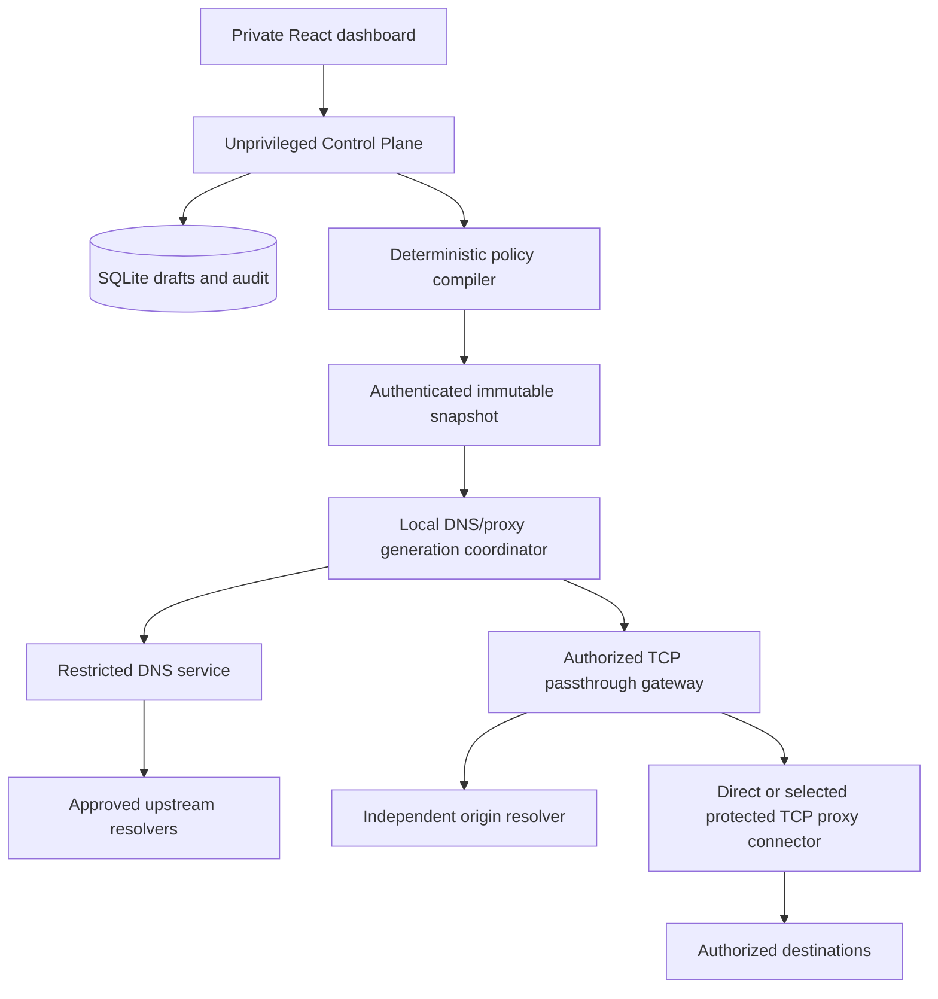

# Proposed architecture

Status: Foundation constraints accepted at P0-01; detailed technical design remains proposed.
The minimal common/config/policy workspace exists; runtime services do not. The DNS/proxy-only MVP
boundary is accepted under [ADR-0016 / CR-0001](adr/ADR-0016-dns-proxy-mvp-before-tunnels.md).
The base specification remains the long-term product reference.
One initial owner can add administrators and assign roles.
The owner accepted P0-01/CR-0002 and authorized work through P0-02. The
[foundation review](../planning/P0_01_FOUNDATION_REVIEW.md) and
[threat model](../security/THREAT_MODEL.md) record the accepted public changing-IP,
DNS-only network/group requirement and proposed registration/expiry contracts.

The subsequent [Control D research](../research/CONTROLD_ANALYSIS.md) produced
accepted [ADR-0017 / CR-0002](adr/ADR-0017-profile-endpoint-dns-product-model.md).
The [DNS product model](DNS_PRODUCT_MODEL.md) separates Profiles, DNS Endpoints,
resolver capabilities, filter/service revisions, private records and proxy grants.
Personal DoH/DoT is now on the revised MVP path; manual network registration is a
bootstrap/fallback, with separately scoped opt-in secure-source observation learning.

## Initial DNS/proxy runtime

A minimal Rust workspace produces a Control Plane service and an independent DNS/proxy
Data Plane service with a local generation coordinator. A Control Plane/database crash must
not stop accepted forwarding. The browser uses authenticated /api/v1 contracts.
The node runs without NET_ADMIN; it needs no VPN client, TUN, managed engine or custom
privileged executor. Only narrow DNS bind capability/socket activation may be needed.

DNS returns addresses; ordinary traffic does not flow through DNS. Compatible SmartDNS
answers direct TCP clients to the gateway. SNI supplies only a candidate target; independent
ingress/service/profile/route authorization and checked origin addresses select the destination.
End-to-end TLS retains the origin certificate. Choose one protected SOCKS5 or HTTP CONNECT
outbound in D19/P0-05; no general engine framework or public explicit-proxy inbound is implied.

DNS-only cannot force ECH/QUIC/IPv6/application traffic through the gateway. Unknown or
ambiguous proxy destinations fail closed. DIRECT at the gateway exits from the VPS.
A proxy failure must not silently select direct egress.

## Logical ownership and future components

Do not materialize a crate per row. Start with only modules needed by the approved task.

| Boundary | MVP ownership | Later extension |
|---|---|---|
| Domain/config | Validated identity/profile/rule types, secret references and schemas | Peer/tunnel/remote-node types when used |
| Pure policy | Deterministic DNS/proxy decisions, no DB or OS calls | Additional verified traffic actions |
| Storage | SQLite repositories, migrations, drafts and consistent backup | PostgreSQL only after measured need |
| DNS/gateway | Scoped cache, binding, origin resolution and bounded TCP transport | Supported UDP/TUN modes after separate acceptance |
| Local coordination | Immutable DNS/gateway generations, durable activation/recovery | Engine plans and remote-node orchestration |
| Proxy outbound | One narrow direct/protected TCP connector | Generic protocol adapters only when justified |
| API/browser | Auth, roles, drafts, publication and truthful diagnostics | Engine/peer/export and multi-node UI later |
| Test support | Actual DNS/TCP/proxy/TLS fixtures and failure injection | Actual engine/tunnel/two-node fixtures |

Possible names follow specification §16: routira-common/config/security/policy/storage/dns/
gateway/core/api and apps/routira-server/web, with fewer initial crates allowed.
Post-MVP G3 adds routira-protocols, concrete adapters, isolated external engines and a narrow
executor only for verified OS actions. G4 adds remote agent/enrollment/control.
Neither the helper nor a generic adapter framework belongs on the MVP dependency path.
Do not make production code depend on test fixtures or use a universal mutable service registry.
P0-02 uses owner-approved Rust 1.99.0/MSRV, Edition 2024 and no external dependencies;
see [workspace posture](../agents/rust.md). Later dependencies/features remain their owning tasks.

WG/AWG terminate tunnels. Managed Xray is a proxy engine; routing tunnel packets into it
requires a separately validated bridge. These contracts and their kernel/engine tests remain
future obligations. Splitting DNS/gateway processes later requires failure-isolation evidence.

## Configuration and consistency

Draft revision → schema/security/conflict/capability validation → deterministic compile/hash
→ authenticated snapshot → durable stage → local validate/prepare → coordinated activate
→ component health verification → active acknowledgment or explicit rollback.

Readers retain immutable generation references. DNS cache separates policy/response scope
and validation provenance. Old route contexts survive TTL/grace only while authorized;
revocation can terminate sessions. Journal and test every activation crash point.
An authenticated rollback publishes old content under a new increasing activation sequence;
ordinary old snapshots are replay, not rollback. Acceptance means no exposed partial ruleset.

Future kernel routes/interfaces and engines cannot join a single database transaction.
Their later prepare/guard/journal protocol needs separate tests. Multi-node publication tracks
per-node outcomes and possible divergence instead of promising global atomicity.

## Identity, secrets and permissions

One-time owner bootstrap closes registration. Owner/admin/operator/read-only permissions
remain proposed in D01/P6-01 with last-owner/recovery protection.
The user accepted shared network access for legacy DNS and transparent TCP. Personal
secure DNS capabilities can independently select different Endpoint Profiles behind
one NAT, but do not authenticate unrelated TCP sessions. Internet MAC, client label
or last DNS query cannot select a gateway Profile. D08/CR-0002 defines manual and
opt-in learned exact-address grants with bounded expiry, conflict rejection and
derived-grant revocation before exposed routing; no implicit source-prefix expansion.

Encrypt credentials with standard libraries and a separately provisioned master key.
Snapshots use scoped secret references; authorize delivery and redact logs/Debug/API/exports.
Block reserved/private/metadata/self IPv4/IPv6 targets on every resolution and dial the checked
address. A selected outbound must preserve origin-address checking/pinning rather than
delegate unchecked target resolution. Keep control IPC authenticated and queues/deadlines bounded.

MVP denies arbitrary OS actions. Future helper requests are typed and allowlisted, never shell
commands or writable-PATH discovery; secrets never appear in argv. Remote node mTLS with
short-lived single-use enrollment is proposed for G4.

## Decisions still requiring validation

Read [open decisions](../planning/OPEN_DECISIONS.md) and the
[ADR index](adr/README.md): CR-0001/CR-0002 and foundation constraints are accepted;
15 technical ADRs retain Proposed status for detailed mechanisms.
Debian 13 x86_64 is the accepted first native target, not tested product compatibility.
Open implementation choices include numeric ingress/grant limits, selected protected
outbound, reference services and TTL/generation grace.
AWG kernels, packet-to-proxy bridges, helper rollback and remote enrollment remain post-MVP.
No DNS/proxy or protocol functionality is claimed before actual implementation and acceptance.
