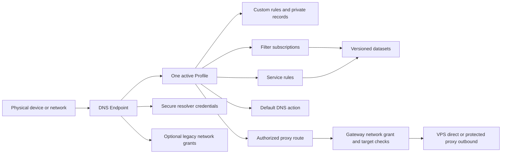

# Routira DNS product model

Status: **Proposed**, 2026-10-15; design revision CR-0002. Prepared at the user's
request using the [Control D analysis](../research/CONTROLD_ANALYSIS.md).
[ADR-0017](adr/ADR-0017-profile-endpoint-dns-product-model.md) records the decision.
This supersedes the manual-IP-only proposal for review, not the preserved base specs
or accepted group authorization limits of ordinary transparent TCP ingress.

## Product structure

An Endpoint is a resolver configuration, not necessarily one physical device.
Create separate endpoints for a phone and laptop to apply different DNS policy;
use one network endpoint for DNS-only TVs/router clients that share policy.
Profiles are reusable and cloneable. MVP uses one active Profile per Endpoint;
profile stacks, schedules and organization inheritance are later work.

## Domain resources and ownership

| Resource | Contract and references |
|---|---|
| Profile | Named policy; custom/service/filter/default layers, private records, approved upstream references and privacy/response settings |
| DnsEndpoint | Stable public EndpointId, name, enabled state, active ProfileId, enabled DNS transports and access mode; optional link to existing Device metadata |
| ResolverCredential | Rotatable/revocable high-entropy capability selecting an Endpoint over DoH path or DoT hostname; separate from public EndpointId and admin credentials |
| FilterListRevision | Immutable normalized domain blocklist; source/owner/license, format, version/hash, limits and validation outcome |
| ProfileFilter | Profile's enabled selection of specific list revisions; no claim of a category feed until actual licensed data exists |
| ServiceGroupRevision | Immutable curated domain patterns and dependencies for a named service, provenance and revision; data, not a transport |
| ServiceRule / CustomRule | Scope, explicit match mode, action, bounded priority within its layer, stable ID and enabled state |
| PrivateDnsRecord | Profile-scoped A/AAAA/CNAME answer; separate from proxy authorization; conflict/loop and cross-profile privacy validation |
| LegacyNetworkGrant | Exact public source /32 or /128 + DNS listener + shared Endpoint/Profile scope, origin, expiry and applied state |
| GatewayNetworkGrant | Separate exact source/listener/group + approved service/target/port/outbound scope; never inferred from an analytics label |
| ProxyOutbound | VPS_DIRECT or one selected protected external TCP proxy, secret references and verified capabilities/observed status |
| Snapshot / Deployment | One authenticated generation pins endpoint assignments, credential verification/revocation state, policies, dataset hashes and route/grant authority |

Stable IDs and enums prevent resource mixups; secret capabilities are never plain
public identifiers. DNS answer actions and traffic actions stay distinct internally.
MVP does not create engine/node/tunnel objects just to fill a target schema.

## Three DNS access cases

| Client setup | DNS policy identity | Proxy authorization |
|---|---|---|
| Personal DoH URL / DoT hostname | Valid resolver capability selects Endpoint/Profile even when source IP changes | Separate applicable network grant required for transparent gateway |
| Only resolver IPs over UDP/TCP | Explicit source-network/listener grant selects a shared endpoint | Shared network scope, never individual device proof |
| Router forwards LAN queries | One network endpoint by default | Same group limits; trusted local per-client forwarding needs a separately verified future integration |

Illustrative, non-operational shapes: DoH
`https://dns.example/dns-query/<resolver-secret>` and DoT
`<resolver-secret>.dns.example`. Provision wildcard/service DNS and valid TLS
certificates before enabling these listeners. Personal resolver settings are still
DNS configuration and need no VPN; client support must be checked.

Treat the capability as a secret bearer value: secure randomness, one-way verifier
or explicitly protected provisioning storage, redacted URL/SNI/access logs and errors,
rotation and applied revocation. DoT hostname identifiers can be visible in DNS/TLS
metadata; encrypted DNS does not make that identifier invisible. A copied credential
shares the endpoint's privileges. Client-name suffixes only label telemetry and
cannot select a privileged Profile. Reject unknown/expired/revoked capabilities.

Legacy identity keys include the listener and actual source address. Two endpoints
behind one NAT cannot select different Profiles on the same legacy listener merely
by their names. Reject ambiguous assignments. Do not assume extra public IPv4/IPv6
resolver allocations or modify host routes/interfaces to manufacture endpoint IPs.
An IPv4 grant never covers unrelated IPv6 sources; no automatic IPv6 /64 grant.

## Dynamic addresses and learned grants

Manual administrator registration/replacement is the G1 bootstrap/fallback.
G2 adds a disabled-by-default option to learn an observed source after valid secure
DNS capability use. The administrator explicitly chooses the destination network
group, allowed grant scopes, lease maximum and services/outbounds that may be learned.
DNS-only legacy authorization and gateway authorization are distinct permissions.

The DNS runtime emits a bounded authenticated observation. The controller validates
it and publishes scoped grant changes through the existing authenticated generation
path; a packet handler does not write SQLite or silently mutate routing authority.
Queue loss/controller outage must not authorize a new network. Secure DNS continues
using valid last-known-good policy; existing network grants still expire locally.
Show observed, pending and applied grant states separately.

Never learn an arbitrary address supplied in query fields or untrusted HTTP headers.
Never learn from a failed token lookup, legacy query, SNI alone, client alias or
unauthorized origin request. Restricted-IP mode cannot bootstrap an unknown IP
through its own learning path; retain private management/manual bootstrap.
Revoke grants derived from a credential when its authority is revoked, unless a
separate current manual grant authorizes that scope. Retain cause and expiry without
unbounded query history. Do not enlarge source prefixes automatically.

Multiple secure DNS endpoints can share a NAT and have different DNS policy. Their
ordinary TCP connections cannot communicate which endpoint supplied the answer.
The gateway therefore has one explicit unambiguous network/group policy for a
given source/listener. A learned observation cannot overwrite it with the most
recent endpoint's Profile. Reject conflicting grant requests; never union permissions
silently. A DNS block on a child endpoint is not per-device enforcement of a stricter
gateway policy when another same-NAT endpoint has broader DNS access.

Detect DNS/proxy source mismatch in diagnostics; do not fix it by permitting an
unknown proxy address. Same-NAT/CGNAT peers share a grant and reassigned old addresses
remain a risk until expiry/applied revocation. Clock rollback/uncertainty handling,
numeric limits and maximum grant lifetime are D08 implementation prerequisites.

DDNS polling, public IP exposure records and a dedicated router helper are deferred.
Adding them needs explicit ownership/update-authentication rules and bounded safe
resolution. No extra client is required for the initial deployment.

## Policy, filters and private names

Evaluate **custom rules > service rules > filter lists > default**. Compile this
precedence into explicit ranks; user priority is within a rank, not a hidden way to
override the category order. Then apply documented match specificity and stable-ID
ordering; reject unresolved contradictory rules before publication.
Explicit BYPASS prevents lower rule layers from choosing an action; default BYPASS
does not suppress filters. Neither bypass disables DNSSEC/security checks, client
authorization, SSRF checks or quotas.

Display BYPASS, BLOCK and REDIRECT, while keeping these internal effects separate:
ordinary DNS answer/upstream selection; DNS denial; local answer override; and a
compatible SmartDNS route to an authorized gateway. REDIRECT to a private DNS record
does not authorize proxying that private address. Gateway DIRECT exits at the VPS;
DNS BYPASS normally lets the client connect to the original destination itself.

Use explicit Exact, DomainAndSubdomains and SubdomainsOnly match modes. Do not import
Control D's complete wildcard grammar or change bare-domain semantics implicitly.
Start with bounded local domain/hosts list imports and operator-curated service
bundles. Reject unsupported formats, malformed/oversized lists and unknown references;
preserve last-known-good on import failure. Store license/provenance/hash and pin the
selected revisions in snapshots; updates require validate/diff/publish. Automatic
internet feed downloading, proprietary category data and ML classification are not MVP.

Private A/AAAA/CNAME records belong to Profiles and are invisible to other scopes.
Returning an authorized private LAN address does not grant the VPS access there.
The gateway still rejects internal/metadata/self destinations. Do not advertise
split-horizon DNS as connectivity into a LAN; dedicated private upstream forwarding
also requires explicit resolver access/loop validation.

## Dashboard and repository structure

Navigation: Overview; Profiles; DNS Endpoints; Filters; Services; Proxy Outbounds;
Activity; Diagnostics; Deployments; Access/Settings. Profile editor tabs expose
Filters, Services, Custom Rules, Private Records and DNS/Privacy settings.
Endpoint setup exposes supported resolver configurations, active Profile, scoped
network grants, secret rotation and actual applied/last-query states. No endpoint
is labelled configured/tested merely because a form was saved.

Illustrative Profiles: Home, Kids and Work. Their names are templates, not a claim
of available malware/adult-content datasets. A missing list is unavailable, not an
empty successful protection toggle. Explain includes layer/rule/profile/endpoint,
dataset revision, DNS and gateway identity scope, outcome and generation. Activity
is aggregated by default; no fabricated per-device TCP attribution or exhaustive history.

Reuse proposed crates: common owns IDs/states; config validates resources; policy
owns matching/catalog compilation; storage owns drafts/revisions/grants; dns owns
UDP/TCP/DoH/DoT endpoint lookup; gateway owns checked passthrough/outbounds; api owns
auth/CRUD/publication. The runtime still survives controller/database loss.
Web feature folders follow profiles/endpoints/filters/services/dns/proxy/diagnostics.
These are boundaries for later implementation, not new placeholder crates.

## Delivery and acceptance

P0-01 reviews this model. P1-01/P1-02/P1-03 establish resources and constraints.
New P2-07 imports versioned catalogs; P2-01..06 compile and explain layered policy.
P3-07 now implements mandatory personal DoH/DoT and diagnostics before P4-08.
P4-01 enforces separate grants; P6-03/P6-04/P7-02..04 expose the product structure.
G1 proves both personal secure transports and the separately group-authorized
gateway path, including negative learning/mismatch cases. G2 finishes the full
Profiles/Endpoints/catalogs/learning-settings UI and release operations.

Required evidence: two secure endpoints behind one NAT with different DNS Profiles;
roaming with a valid resolver capability; revoked/unknown capability denial; legacy
group selection/conflict rejection; no learning from untrusted input; no last-query
gateway-profile switch; source-IP mismatch failure; private-record isolation without
SSRF; dataset import/update failure and rollback; actual TLS certificate/egress proof;
lease expiry during CP outage and credential-derived grant revocation.
No feature is accepted based solely on Control D documentation or this design.
